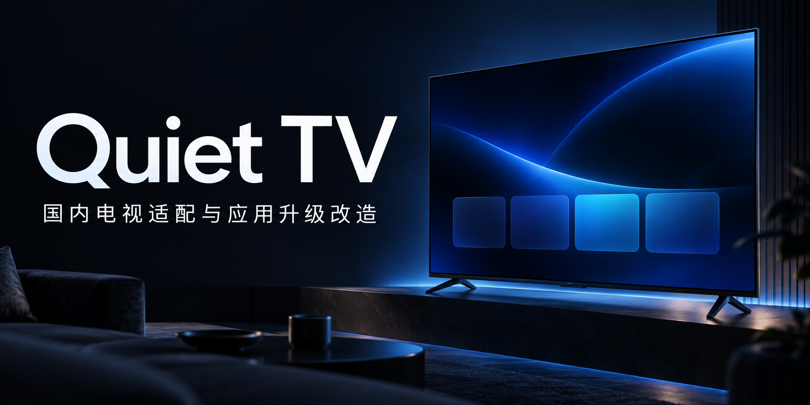
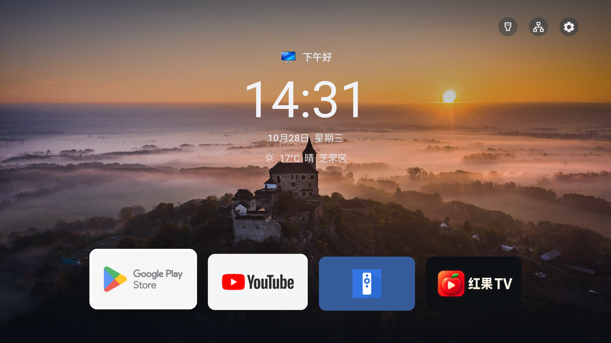
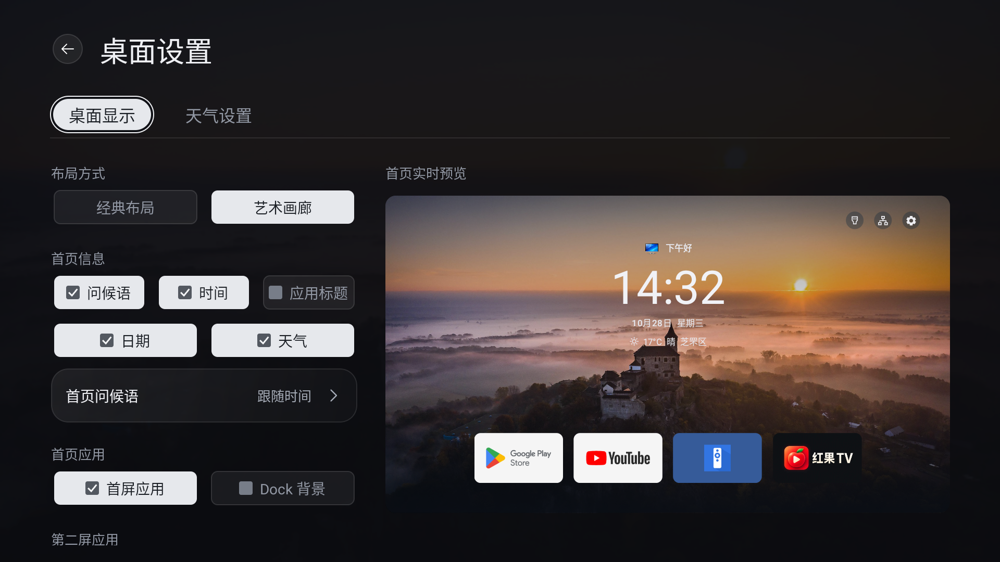
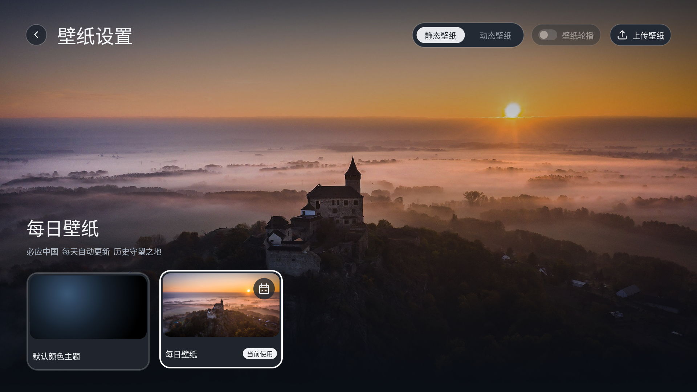
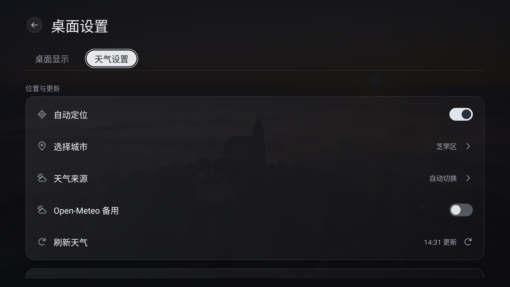
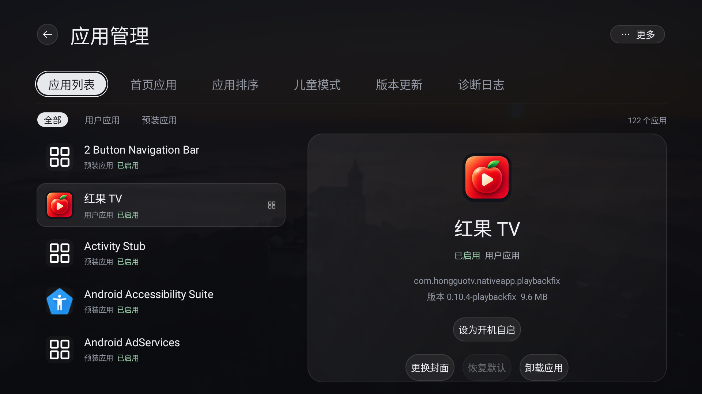
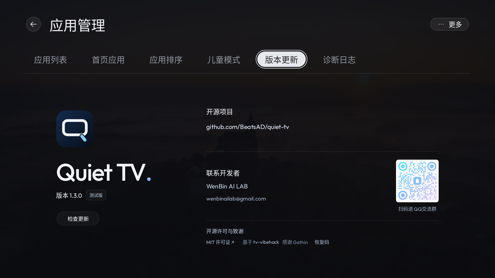
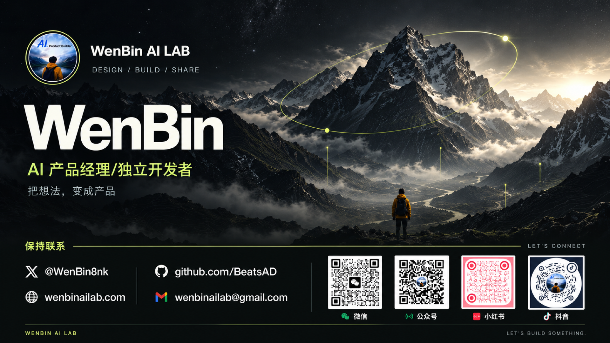

<p align="center"></p>

<h1 align="center">Quiet TV</h1>

<p align="center"><strong>A simple, customizable launcher for Android TVs.</strong></p>

<p align="center">
  <a href="README.md"></a>
  <a href="README.en.md"></a>
</p>

<p align="center">
  Favorite apps, inputs, wallpapers and app management, all from your remote.<br>
  Native Android UI. No ads, recommendation feed, account, root or firmware flashing.
</p>

<p align="center">
  <a href="https://beatsad.github.io/quiet-tv/"></a>
  <a href="docs/INSTALL.en.md"></a>
  <a href="docs/USAGE.en.md"></a>
</p>

<p align="center">
  <a href="https://github.com/BeatsAD/quiet-tv/releases"></a>
  <a href="LICENSE"></a>
  <a href="docs/COMPATIBILITY.md"></a>
  <a href="docs/COMPATIBILITY.md"></a>
</p>

## Download

The [installation page (Chinese)](https://beatsad.github.io/quiet-tv/), [Agent guide](https://beatsad.github.io/quiet-tv/agent.md), and [latest release index](https://beatsad.github.io/quiet-tv/latest.json) update automatically from published releases, including test builds. Users do not need to maintain a version number or edit the installation request for each release.

**Choose the latest build compatible with the TV's Android version, supported ABIs, package, signer and upgrade conditions.** Use the Android 4.0–4.4 compatibility test APK for API14–20 or an applicable standard APK for API21+. Inspect the actual APK metadata; a larger build number or a 64-bit processor alone does not establish compatibility.

The 1.3.1 test release provides two APKs: a universal Android 5.0+ build (146, minimum API21) and an Android 4.0–4.4 compatibility build (147, minimum API14). Neither contains native libraries, so separate ARM32 and ARM64 downloads are unnecessary; choose by Android version. The compatibility build has no standard desktop guard, HOME proxy or standard TV Input list; use system settings or the physical remote for inputs.

Existing 1.3.0 standard and legacy14 installations can check for in-app updates. Older legacy19 clients need a manual download to move to legacy14. A higher build of the same software version does not trigger an update prompt. Check the package, signer and increasing build number first; do not uninstall or clear data.

Use the index's actual download URL and SHA-256, or a matching checksum attachment for historical builds. Read the selected release's validation limits. [Historical releases](https://github.com/BeatsAD/quiet-tv/releases) remain unchanged.

## Screenshots

<table>
  <tr>
    <td width="50%" valign="top">
      <p><strong>Favorite apps, time and weather at a glance.</strong></p>
      
    </td>
    <td width="50%" valign="top">
      <p><strong>Classic and Art Gallery layouts with a live preview.</strong></p>
      
    </td>
  </tr>
  <tr>
    <td width="50%" valign="top">
      <p><strong>Daily wallpaper, with uploads for your photos and videos.</strong></p>
      
    </td>
    <td width="50%" valign="top">
      <p><strong>Automatic location, city selection and weather sources.</strong></p>
      
    </td>
  </tr>
  <tr>
    <td width="50%" valign="top">
      <p><strong>Filter apps by category and inspect their details.</strong></p>
      
    </td>
    <td width="50%" valign="top">
      <p><strong>View the current version and check for app updates.</strong></p>
      
    </td>
  </tr>
</table>

## Features

These core features describe the 1.3.1 test release. Use the live release index and choose a build compatible with the TV's system and installed package.

| Feature | What it does |
| --- | --- |
| Favorites and order | Up to five favorite apps; long-press to move, add, replace, hide or request uninstallation, with hidden-app restoration in App Management. |
| Personalization | Classic or Art Gallery, custom greetings and avatars, independent information and shortcut visibility. |
| Weather | Automatic location, manual city selection and phone-assisted city entry. |
| Wallpapers | Color theme, Bing daily wallpaper, photos and videos; a capsule dropdown for rotation intervals, video sound and optional naming during phone uploads. |
| Desktop screensaver | Shared wallpaper media with independent selection, idle delay, time and weather controls. |
| File transfer | LAN uploads and downloads start on page entry; browse local or USB files, preview and import wallpapers, and switch sources with arrow keys. |
| App management | Category filters, package details and custom artwork; local TCP ADB enables disable, re-enable, uninstall and restore-install actions allowed by device rules and firmware capabilities. |
| Child mode | Hide or lock apps, set per-session or daily limits, and use parent verification and rest reminders. |
| App autostart | Open a selected app after boot or standby wake enters Quiet TV, without repeating on ordinary HOME returns. |
| Inputs and home setup | Open supported input/settings routes; computer AI configures HOME or compatibility paths and retains stock-home recovery. |
| In-app updates | Check versions, download from multiple sources, verify integrity and signing, then confirm installation. |
| Remote and local use | Arrows, OK and Back, optional key sounds and computer-assisted key calibration where supported; no cloud account. |

Open All Apps → 桌面设置 for Desktop, Weather, App Management, Child mode, File transfer, Version updates and Diagnostic logs. Everyday desktop, ordering, wallpaper, weather and artwork settings need no ADB. Computer AI tools handle initial connection setup, authorization, device adaptation and requested boot-ad maintenance. The TV retains daily management over a configured local TCP ADB connection, with no wireless-pairing interface; a computer connection does not authorize the app. See [app management](docs/APP_MANAGEMENT.md).

Version 1.3.1 adds file transfer, an independent screensaver, rotation intervals, phone upload naming and Home long-press management. It improves computer calibration and maintenance, wallpaper selection, parent verification, timer status, installation preflight and video handoff, including desktop-return black flashes. See the full [1.3.1 release notes](https://github.com/BeatsAD/quiet-tv/releases/tag/v1.3.1).

The signed update feed is live. Automatic checks run every 24 hours while Home is in the foreground; manual checks are under Desktop Settings → Version updates → Check for updates (App Management in 1.3.0, About in older APKs). Older versions without this feature need a manual installation first. A higher build of the same software version is not offered as an update. See [in-app updates](docs/UPDATES.md).

## Install and try it

1. Confirm Android support, choose the matching APK above, and [verify its checksum](docs/INSTALL.en.md#download-and-try).
2. Follow [installation](docs/INSTALL.en.md), or use the [computer Agent instructions, Chinese](docs/AGENT.md).
3. Version 1.3.1 opens Home without an automatic setup wizard. Check navigation, apps and system entries; keep any desktop configuration already completed by the AI tool.
4. Use the computer AI workflow to configure HOME when ready. Read back the component, then separately verify the physical Home button, reboot and standby wake. Recovery is under 桌面设置 → 更多 → 帮助与恢复 (Help and recovery); see [setup](docs/SETUP.md).

Updates need matching package/signature and an increasing build number. Do not uninstall to resolve signing mismatches. Keep backups and recovery records locally, and never reuse another TV's debloating list.

## Supported devices and validation

| System or device | Scope |
| --- | --- |
| Android 5.0+ TVs | 1.3.1 universal standard test APK (146), minimum API21. |
| Android 4.0–4.4 | 1.3.1 compatibility test APK (147), minimum API14. Physical Android 4.x runtime and upgrade acceptance remain pending. |
| Tizen, webOS and other non-Android systems | Unsupported. |

The two 1.3.1 APKs share one source baseline, software version and test signer. Build, Lint, metadata and checksum checks passed, as did 31 rotation and file-transfer unit tests and the public Validate check. Final builds 146/147 have not been installed on a device. Final-package feature checks, in-place upgrade retention, Android 4.x runtime and vendor-TV acceptance are explicitly deferred; earlier emulator results do not validate these final APKs.

See [compatibility and historical evidence](docs/COMPATIBILITY.md). Third-party media apps update through their own channels; Quiet TV does not automatically update them.

## Known issues and hardware validation

Updated 2026-10-29. Results apply to the recorded model, firmware and software version.

**Known issues**

| Issue | Current status | Pending validation |
| --- | --- | --- |
| Home takeover | Skyworth E6100 (Android 4.4.2) returns to stock Home when the Home key is pressed in trial mode | Takeover options, reboot, cold boot and standby wake |
| Inputs and Menu key | Skyworth 55H6 / 1.3.0 reports an input screen at boot, input-switching problems and an unresponsive Menu key | Physical-TV retesting after fixes |
| Weather and daily wallpaper | Hisense VIDAA_TV (Android 4.4.2) had connection failures on an older version; compatibility fixes have since shipped. See [#68](https://github.com/BeatsAD/quiet-tv/issues/68#issuecomment-6430967402) | Retest weather and daily wallpaper separately after upgrading |
| ADB connection | Some firmware restricts debugging access or authorization | Available connection methods and connectivity after reboot or standby |

**Hardware validation results**

| Device and version | Available results | Pending validation |
| --- | --- | --- |
| Coocaa / Skyworth 55G20, Android 8, 1.2.9 | User confirms physical Home and reboot into Quiet TV. See [#35](https://github.com/BeatsAD/quiet-tv/issues/35#issuecomment-6440081087) | Cold boot, standby, inputs and stock-home recovery |
| Xiaomi Box 2 Enhanced, Android 4.4.2, 1.2.4 | User reports successful installation and normal use. See [#81](https://github.com/BeatsAD/quiet-tv/issues/81) | Individual feature acceptance, later upgrades and Dock-toggle retesting |
| Sony BRAVIA VH1, Android 12, historical 1.2.4 (64) | In-place installation and page checks completed | Full features, retention of all data, physical Home, cold boot, reboot and standby |

See the [device records](docs/COMPATIBILITY.md#样机验证记录) for models, firmware and evidence. Share redacted test results through the [device adaptation form](https://github.com/BeatsAD/quiet-tv/issues/new?template=device_adaptation.yml).

## Technical approach

Native Android UI → build an APK → install with ADB → configure HOME → refine on real hardware. Daily use does not require an online computer.

Use the [unified computer AI guide, Chinese](docs/AGENT.md) for installation, upgrades, adaptation and recovery. The [Codex implementation and adaptation guide, Chinese](docs/TECHNICAL_PATH_WITH_CODEX.zh-CN.md) covers development tools and debugging authorization. The computer obtains the TV's actual ADB authorization; no in-app ADB client is required.

## Documentation and contributing

| I want to… | Read |
| --- | --- |
| Browse documentation and repository layout | [Documentation index](docs/README.md) |
| Install, update, or switch back to my original launcher | [Installation guide](docs/INSTALL.en.md) |
| Configure favorites, wallpaper, or remote navigation | [Usage guide](docs/USAGE.en.md) |
| Configure HOME on request or restore the original launcher | [Home setup and recovery, Chinese](docs/SETUP.md) |
| Check device support and validated behavior | [Compatibility](docs/COMPATIBILITY.md) · [Verification record](docs/COMPATIBILITY.md) |
| Build or contribute | [Contributing](CONTRIBUTING.md) · [Version and APK rules](docs/VERSIONING.md) |
| Review security and repository settings | [Security policy](SECURITY.md) · [Contributing](CONTRIBUTING.md) |

Feedback: [Bug report](https://github.com/BeatsAD/quiet-tv/issues/new?template=bug_report.yml) · [Feature request](https://github.com/BeatsAD/quiet-tv/issues/new?template=feature_request.yml) · [Device adaptation](https://github.com/BeatsAD/quiet-tv/issues/new?template=device_adaptation.yml)

The repository, documentation, and test APK downloads are public. Sign in to GitHub to submit feedback.

## Contribute and maintain

Help with native Android features, remote navigation, documentation, translations, device validation, or tests. Start with a [good first issue](https://github.com/BeatsAD/quiet-tv/issues?q=is%3Aissue%20is%3Aopen%20label%3A%22good%20first%20issue%22) or [help wanted task](https://github.com/BeatsAD/quiet-tv/issues?q=is%3Aissue%20is%3Aopen%20label%3A%22help%20wanted%22), comment before starting, and submit a PR from your fork.

The [contribution guide](CONTRIBUTING.md) covers setup, checks, and review. Use [Discussions](https://github.com/BeatsAD/quiet-tv/discussions) for questions, larger ideas, or joining ongoing maintenance. Follow our [code of conduct](CODE_OF_CONDUCT.md).

To build locally, install Git, Python 3, JDK 17, Android SDK platform 36, and build-tools 36.0.0. Set `ANDROID_HOME` or your own `sdk.dir` in `local.properties`, then run:

```sh
git clone https://github.com/BeatsAD/quiet-tv.git
cd quiet-tv
./gradlew :app:assembleDebug --console=plain
```

The Debug APK is written to `app/build/outputs/apk/debug/app-debug.apk`. Building and offline checks need neither a TV connection nor `device.json`. Use ADB as described in the [installation guide](docs/INSTALL.en.md) when installing on your own TV; preserve existing files and backups. Follow [version and APK rules](docs/VERSIONING.md) for archiving, signing, and APK delivery.

Native source is in `app/`, build and device tools in `scripts/`, and `prototypes/about/` supplies actual APK bundle inputs. Device data, standalone web demos, and promotional video work are excluded from the current source tree. See the [documentation index](docs/README.md) for the complete layout.

## Credits and license

Quiet TV is based on [Gathin23/cleanyourtv](https://github.com/Gathin23/cleanyourtv). Thank you to **Gathin** for the original work. This project is independently maintained and is not officially affiliated with the upstream project or TV and application brands.

Project code uses [MIT](LICENSE), preserving the copyrights of Gathin and Quiet TV contributor BeatsAD, the permission notice and disclaimer. Third-party code, fonts, icons, weather data, images and videos retain their respective licenses or service terms; see [third-party notices](THIRD_PARTY_NOTICES.en.md).

## Let's connect


