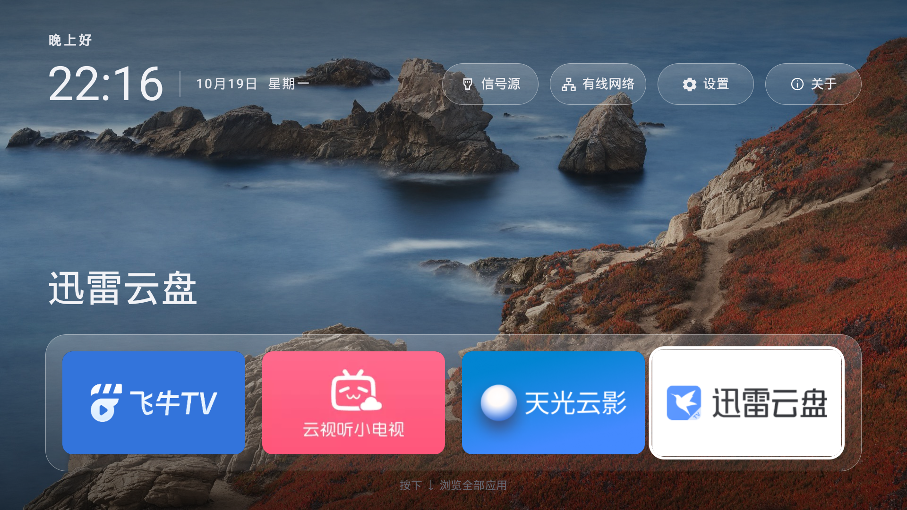
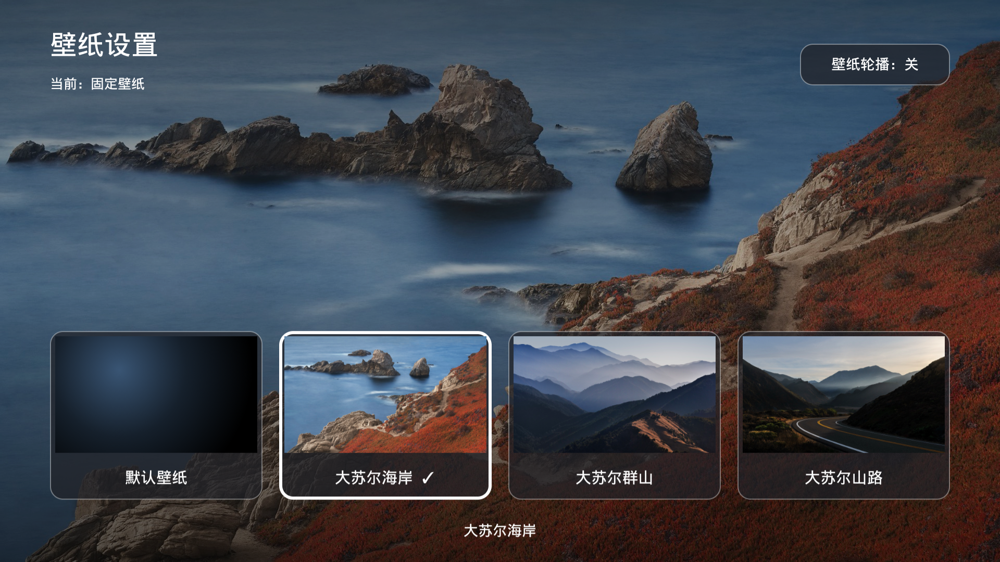

<p align="center"></p>

# Quiet TV

**A simple, customizable home screen for Android TVs.**

[简体中文](README.md) · [English](README.en.md)

Quiet TV is built for everyday TV use in China. Keep your favorite apps on the home screen, open them with your remote, switch inputs, choose a wallpaper, and manage installed applications.

The launcher has no ads or recommendation feed and requires no account. It uses native Android views and needs no root access or firmware changes.

[Android 4.4 test APK](https://github.com/BeatsAD/quiet-tv/releases/tag/v1.1.0-b30) · [Android 5+ test APK](https://github.com/BeatsAD/quiet-tv/releases/tag/v1.1.0-b26) · [Install](docs/INSTALL.en.md) · [Usage](docs/USAGE.en.md) · [Supported devices](docs/COMPATIBILITY.md) · [Known issues and hardware validation](#known-issues-and-hardware-validation)

## Screenshots

**Your favorite apps, right on the home screen.**

A clock, date, favorite apps, and system shortcuts keep the main screen simple. A white focus outline follows the remote selection; press down to browse all apps.



**Choose a wallpaper, or keep the default theme.**

Use the app-colored ambient theme, a fixed photo, or a five-minute slideshow. Current source adds wallpaper management and LAN uploads; see the [usage guide](docs/USAGE.en.md#wallpapers). These additions are not in the existing b26 download and await real-TV acceptance.



These original Sony KD-65X9000H captures were taken on October 19, 2026, with development build 1.1.0 / b15. Downloads include b30 compatibility and retained b26 standard builds; these captures do not establish hardware validation of either APK. The cover is an AI illustration. See [image provenance](docs/assets/README.md).

## Features

| Feature | What it does |
| --- | --- |
| Favorite apps | Keep up to four apps on the home screen. Add, replace, remove, and reorder them; launcher updates preserve your selection. |
| App management | Inspect app names, package names, versions, and status. Search, filter, and enable, disable, or uninstall apps individually. Protected system components stay read-only. |
| Boot-ad management (new in source) | Inspect verified advertising services, disable them on demand, and restore their original enabled state independently of HOME. No boot-ad profiles have passed Quiet TV hardware acceptance yet; unmatched devices remain read-only. Existing b30 downloads do not include this feature. |
| First setup | Set the default home screen, then optionally manage preinstalled apps. Choose actions before authorizing them; system packages on unknown firmware stay read-only. |
| Restore the original launcher | Switch back to or enable the original launcher using local records and validated device capabilities. Unavailable actions explain why they are blocked. |
| Inputs and settings | Choose from the TV's actual inputs, including HDMI, AV, or live TV where available. Source now includes selected firmware's system input-panel fallbacks; see [compatibility](docs/COMPATIBILITY.md). Open network and system settings directly. |
| Wallpaper | Preview and choose the default ambient theme, a fixed landscape, or an automatic slideshow. Cancel to restore your previous choice. |
| Remote navigation | Use direction keys to move, OK to open, and Back to return. The home screen remembers your last focus. |
| Local use | Settings stay on the TV. No cloud account is needed; app management connects to the TV's own ADB service on demand. |
| About and licenses | View the installed version and project/contact QR codes from the home screen. Bundled open-source licenses are available offline. |

The home screen supports Chinese and English; app management currently uses Chinese. Open “应用管理” from the all-apps screen to manage apps and edit favorites. Wallpaper settings are also available on the TV.

System package operations require local ADB authorization. Disabling keeps app data; uninstalling deletes data for the current user. Eligible preinstalled apps can be reinstalled, but deleted data cannot be restored. Preinstalled uninstall/reinstall remains unverified on hardware; see [app management details](docs/APP_MANAGEMENT.md).

Source is **1.1.2**, with default versionCode 34 and versionCode 35 for this Android 4.4 delivery with two build profiles: `standard` (Android 5.0+ / API21) and `legacy19` (Android 4.4 / API19). The legacy profile retains the core launcher and traditional TCP ADB, uses system settings for inputs, and omits six-digit pairing and its native crypto libraries. Public prereleases include b30 / Android 4.4 and the retained b26 / Android 5.0+ standard APK. See the [build guide](docs/INSTALL.en.md) and [validation boundaries](docs/COMPATIBILITY.md).

## Install and try it

1. **Check your TV.** Choose b30 for Android 4.4, or the retained b26 standard APK for Android 5.0 and later. Meeting this minimum does not establish device or feature compatibility. Read the supported-device table below and the [compatibility details](docs/COMPATIBILITY.md).
2. **Get an APK.** Download the APK and SHA-256 file from [b30 compatibility](https://github.com/BeatsAD/quiet-tv/releases/tag/v1.1.0-b30) or [b26 standard](https://github.com/BeatsAD/quiet-tv/releases/tag/v1.1.0-b26), or build from source using the [installation guide](docs/INSTALL.en.md).
3. **Install and try the launcher.** Follow the guide to connect ADB and install Quiet TV. A fresh install opens setup; choose “暂不设置，临时使用” to try it temporarily and check your remote, app launches, and system shortcuts first.
4. **Complete first setup.** Set the default home screen, then choose whether to manage preinstalled apps. Select “不处理，进入桌面” to skip package changes. Upgrades do not force setup again. Reopen it through “应用管理 → 更多 → 首次设置”; the same menu offers “恢复原桌面” to restore the original launcher. See [first setup and recovery, Chinese](docs/SETUP.md).

For Android 4.4, download **v1.1.0 / b30, an optimized compatibility test APK of about 2.30 MiB**: `quiet-tv_1.1.0_b30_benchmark_legacy19_api19.apk`. It requires API19, targets API36, and contains no native libraries, so no CPU-specific APK selection is needed. It retains the launcher, Dock, wallpaper and TCP ADB, without six-digit pairing; inputs open system settings. The optimized build, 19 unit tests, Lint (0 errors, 39 warnings), signature and metadata checks passed. Native emulator acceptance was not completed for b30; no physical TV has received it. Historical b28 emulator tests do not validate this APK. See [compatibility](docs/COMPATIBILITY.md).

The retained **v1.1.0 / b26 standard APK is an optimized universal test build of about 6.50 MiB**. Its filename is `quiet-tv_1.1.0_b26_benchmark_api21.apk`; it requires Android 5.0 / API21 and includes `armeabi-v7a`, `arm64-v8a`, `x86`, and `x86_64`. It uses the same test signature as b24 for eligible in-place updates. It remains a prerelease; no stable release is available yet.

Changes in the retained b26 standard build:

- Android 5.0 minimum, legacy networking and permission handling, and graceful handling of unavailable TV input services.
- Android 5 WebView fallback for offline licenses, corrected legacy vector paths and theme attributes.
- Release-to-activate behavior on About prevents the confirmation key from reopening it after returning home.
- ADB completion markers use the legacy shell's built-in `echo`, retaining identity, timeout and capability checks.

b26 passed builds, 19 local unit tests and Lint with 0 errors and 28 warnings. API21/22/23/31 page regressions, API21/22 optimized smoke and API31 shell ADB operation checks passed. APK metadata, architectures, signatures and emulator-installed hashes were verified. **This APK has not been installed on a physical TV; Android 5 HOME, remote keys, inputs, network changes and reboot/wake behavior still need hardware validation.** See the [b26 release notes](https://github.com/BeatsAD/quiet-tv/releases/tag/v1.1.0-b26) for checksums and exact limits.

Historical [b24 universal APK](https://github.com/BeatsAD/quiet-tv/releases/tag/v1.1.0-b24) (Android 6.0+), [b23 ARM32 APK](https://github.com/BeatsAD/quiet-tv/releases/tag/v1.1.0) (Android 12+) and v1.0.1 remain available. b23 hardware checks do not validate b26. Default source Debug builds differ from the published optimized APK; see [build rules](docs/VERSIONING.md).

You can keep the original launcher installed while trying Quiet TV. System debloating requires a backup and recovery record for the actual target TV. Real device settings, package inventories, and recovery records stay local; these are not distributed with public source, and another TV’s records are not a recovery baseline for your device.

## Supported devices

| Device / system | Status |
| --- | --- |
| Sony KD-65X9000H / BRAVIA VH1 · Android 12 | Historical builds were checked for the home screen, app management, wallpaper, selected system shortcuts, and one full reboot. This b26 APK has not been installed on this TV. See the [verification record](docs/COMPATIBILITY.md) for the exact scope. |
| Other TVs running Android 6.0 or newer | The b26 universal APK is available for device-specific trials; vendor firmware, HOME and ADB capabilities need hardware validation. See the [compatibility record](docs/COMPATIBILITY.md). |
| Android 5.0 / 5.1 | The b26 universal test APK is available. Tests use generic Android images with a TV-sized configuration and do not replace native TV firmware acceptance. Vendor HOME, ADB and TV input behavior needs hardware validation. |
| Android 4.4 | Download the [b30 compatibility test APK](https://github.com/BeatsAD/quiet-tv/releases/tag/v1.1.0-b30); physical TV, HOME, input and ADB acceptance remains device-specific. |
| Android 4.0–4.3; non-Android systems such as Tizen or webOS | Unsupported. |

Long-running operation, casting, and full media playback remain unverified. Six-digit wireless pairing is still experimental, requires API 33+ and actual device pairing capability, and is unavailable on Android 5/6/7. Meeting the minimum install requirement does not establish full firmware compatibility; see [compatibility details](docs/COMPATIBILITY.md). Third-party media apps use their own update channels; Quiet TV does not currently update them automatically.

## Known issues and hardware validation

**These issues remain unresolved or unverified. More physical TVs across brands, models, and firmware versions are needed; they must not be treated as fixed.** Successful installation, manual launch, or HOME resolution does not establish correct boot, physical Home-button, or post-reboot behavior. See the current report in [Issue #35](https://github.com/BeatsAD/quiet-tv/issues/35).

| Issue | Current behavior and validation needed |
| --- | --- |
| Vendor home takeover | Firmware may restore its own launcher at boot or have the Home button start a vendor Activity directly, bypassing standard HOME preferences. Cold boot, reboot, and wake from standby need separate checks. |
| Default-home command fails | A report includes `cannot be home on user 0`. The installed APK, current user, HOME candidates, and vendor restrictions need investigation; the cause and adaptation remain unconfirmed. |
| Default-home status is insufficient | Detection mainly uses HOME Intent resolution. Quiet TV may report that it is the default while the physical Home button or a reboot still opens the stock launcher. Status reporting and persistence verification need improvement. |
| ADB disabled or inaccessible | Greyed-out USB debugging, missing wireless debugging, or an unavailable pairing code may prevent local app management and ADB-dependent adaptation. The built-in ADB client cannot bypass firmware restrictions or pairing authentication; there is no universal unlock method. |

Current development source adds built-in experimental home compatibility to the standard app, under Desktop Settings and first-time setup. Xiaomi/Redmi and Skyworth/Coocaa devices can select a detected stock homepage, manually authorize accessibility, and enable the guard. It matches the exact home window, does not read screen contents or change the system HOME preference, and keeps the stock launcher available. The Android 4.4 profile disables the entry and service. **Unpublished and untested on the target TVs; physical Home, reboot, standby and uninterrupted HDMI/playback remain unverified.** See [enable and pause instructions](docs/SETUP.md#主页兼容实验).

The standalone [Xiaomi home helper](xiaomi-home-helper/README.md) remains available as an alternative experiment; disable its accessibility service before enabling the built-in guard. Existing helper settings are not migrated automatically.

An optional standalone [Coocaa home shim](coocaa-home-shim/README.md) adapts the upstream helper for Android 8 firmware confirmed to use vendor homepage properties. **This port has not been validated on a physical TV, is not enabled in the universal APK, and cannot unlock ADB.** Log-based monitoring remains unimplemented. Upstream device results do not validate this port. Keep the stock launcher and local recovery records; do not copy another TV's system-package disable list.

Share results in [Issue #35](https://github.com/BeatsAD/quiet-tv/issues/35) or a [device adaptation report](https://github.com/BeatsAD/quiet-tv/issues/new?template=device_adaptation.yml): model, Android/firmware version, Quiet TV version and APK source, reproduction steps, and actual results for manual launch, the physical Home button, cold boot/reboot, standby wake, inputs, and stock-launcher recovery. Mark untested items as unverified. Share only relevant redacted log excerpts; omit IP addresses, serial numbers, keys, and full device dumps.

## Documentation and contributing

| I want to… | Read |
| --- | --- |
| Browse documentation and repository layout | [Documentation index](docs/README.md) |
| Install, update, or switch back to my original launcher | [Installation guide](docs/INSTALL.en.md) |
| Configure favorites, wallpaper, or remote navigation | [Usage guide](docs/USAGE.en.md) |
| Complete first setup or restore the original launcher | [First setup and recovery, Chinese](docs/SETUP.md) |
| Check device support and validated behavior | [Compatibility](docs/COMPATIBILITY.md) · [Verification record](docs/COMPATIBILITY.md) |
| Build or contribute | [Contributing](CONTRIBUTING.md) · [Version and APK rules](docs/VERSIONING.md) |
| Review security and repository settings | [Security policy](SECURITY.md) · [Contributing](CONTRIBUTING.md) |

Feedback: [Bug report](https://github.com/BeatsAD/quiet-tv/issues/new?template=bug_report.yml) · [Feature request](https://github.com/BeatsAD/quiet-tv/issues/new?template=feature_request.yml) · [Device adaptation](https://github.com/BeatsAD/quiet-tv/issues/new?template=device_adaptation.yml)

The repository, documentation, and test APK downloads are public. Sign in to GitHub to submit feedback.

## Contribute and maintain

Help with native Android features, remote navigation, documentation, translations, device validation, or tests. Start with a [good first issue](https://github.com/BeatsAD/quiet-tv/issues?q=is%3Aissue%20is%3Aopen%20label%3A%22good%20first%20issue%22) or [help wanted task](https://github.com/BeatsAD/quiet-tv/issues?q=is%3Aissue%20is%3Aopen%20label%3A%22help%20wanted%22), comment before starting, and submit a PR from your fork.

The [contribution guide](CONTRIBUTING.md) covers setup, checks, and review. Use [Discussions](https://github.com/BeatsAD/quiet-tv/discussions) for questions, larger ideas, or joining ongoing maintenance. Follow our [code of conduct](CODE_OF_CONDUCT.md).

To build locally, install Git, Python 3, JDK 17, Android SDK platform 36, and build-tools 36.0.0. Set `ANDROID_HOME` or your own `sdk.dir` in `local.properties`, then run:

```sh
git clone https://github.com/BeatsAD/quiet-tv.git
cd quiet-tv
./gradlew :app:assembleDebug --console=plain
```

The Debug APK is written to `app/build/outputs/apk/debug/app-debug.apk`. Building and offline checks need neither a TV connection nor `device.json`. Use ADB as described in the [installation guide](docs/INSTALL.en.md) when installing on your own TV; preserve existing files and backups. Follow [version and APK rules](docs/VERSIONING.md) for archiving, signing, and APK delivery.

Native source is in `app/`, build and device tools in `scripts/`, and `prototypes/about/` supplies actual APK bundle inputs. Device data, standalone web demos, and promotional video work are excluded from the current source tree. See the [documentation index](docs/README.md) for the complete layout.

## Credits and license

Quiet TV is based on [Gathin23/tv-vibehack](https://github.com/Gathin23/tv-vibehack). Thank you to **Gathin** for the original work. This project is independently maintained and is not officially affiliated with the upstream project or TV and application brands.

Code is licensed under [MIT](LICENSE), preserving the original copyright and complete license. Fonts, wallpaper, and third-party application artwork have their own terms; see [third-party notices](THIRD_PARTY_NOTICES.md).

## Let's connect


For a computer Agent workflow, see [installation and recovery instructions (Chinese)](docs/AGENT_INSTALL.zh-CN.md). Preserve the original launcher and report installation, real HOME-key behavior, reboot and standby separately.

Source-only compatibility updates add callable vendor app entries, OEM settings routing, display/memory-aware image handling and scoped input routes. Existing public APKs do not include these changes. See the [implementation and validation scope](docs/COMPATIBILITY.md#本轮源码兼容改进); OEM hardware acceptance remains pending.
