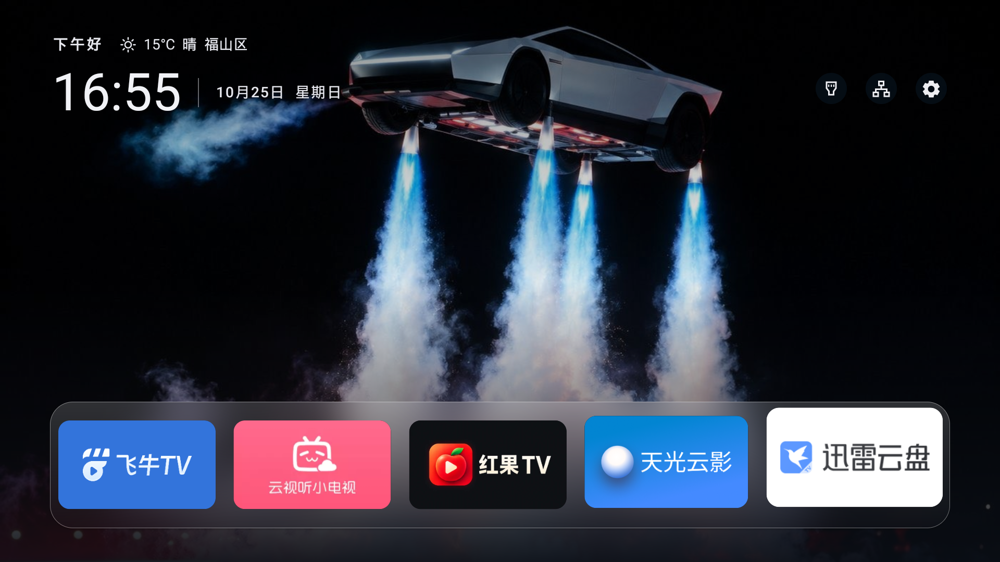
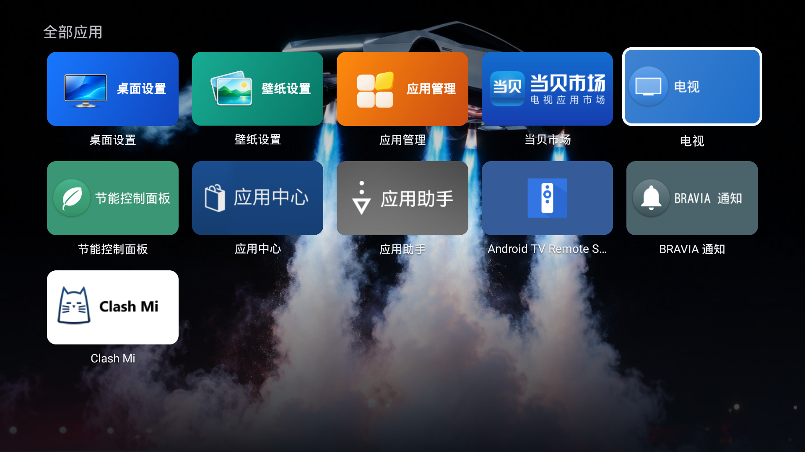

<p align="center"></p>

# Quiet TV

**一个简洁、可自定义的 Android 电视桌面。**

[简体中文](README.md)  [English](README.en.md)

把常用应用放在首页，用遥控器直接打开，方便地切换信号源、调整壁纸和管理应用。桌面没有广告和推荐信息流，无需注册账号。采用 Android 原生界面，无需 root 或刷机。

[下载最新适配版](https://beatsad.github.io/quiet-tv/)  [安装方式](#安装方式)  [使用指南](docs/USAGE.zh-CN.md)  [兼容范围](docs/COMPATIBILITY.md)

## 界面

<table>
  <tr>
    <td width="50%" valign="top">
      <p><strong>首页放常用应用，时间、天气和快捷按钮按需显示。</strong></p>
      
    </td>
    <td width="50%" valign="top">
      <p><strong>全部应用五列显示，排序自动保存。</strong></p>
      
    </td>
  </tr>
  <tr>
    <td width="50%" valign="top">
      <p><strong>经典布局与艺术画廊，调整时实时预览。</strong></p>
      
    </td>
    <td width="50%" valign="top">
      <p><strong>每日壁纸、自己的图片与视频，都能放到电视上。</strong></p>
      
    </td>
  </tr>
</table>

以上为索尼 BRAVIA VH1 / Android 12 上的 1.2.4 真机截图，直接获取原始画面。更多界面见[使用指南](docs/USAGE.zh-CN.md)，版本与来源见[素材说明](docs/assets/README.md)。

## 功能

以下配置方式描述当前源码；电脑适配迁移与覆盖升级修复尚未随新 APK 发布。下载仍以[实时发布索引](https://beatsad.github.io/quiet-tv/latest.json)为准，旧包按实际入口与接口能力操作，不能仅更新脚本就获得新能力。

| 功能 | 可以做什么 |
| --- | --- |
| 常用应用与排序 | 首页最多 5 个常用应用；全部应用五列显示，移动排序自动保存。 |
| 桌面个性化 | 经典／艺术画廊布局，自定义问候语和头像，各项信息与快捷按钮独立显隐。 |
| 天气 | 自动定位、手动选城和手机扫码选城，首页显示当地天气。 |
| 壁纸 | 默认颜色主题、必应每日壁纸、自定义图片和视频；同局域网扫码上传，长按确定删除。 |
| 应用管理 | 分类筛选、应用详情、自定义封面及日常整理；系统禁用与恢复由电脑 AI 按规则处理。 |
| 儿童模式 | 隐藏或锁定应用、设置单次或每日使用时长，家长验证与到时休息提醒。 |
| 应用自启 | 开机或待机唤醒进入 Quiet TV 后启动指定应用，按 HOME 返回不重复启动。 |
| 信号源与桌面配置 | 按本机能力打开输入和系统设置；电脑 AI 配置默认桌面或兼容接管，保留原桌面恢复路径。 |
| 应用内更新 | 检查版本、多源下载、完整性与签名校验，由用户确认安装。 |
| 遥控器与本地使用 | 方向键、确定、返回操作；无需云端账号，个人设置保存在电视。 |

从“全部应用 → 应用管理”进入“应用列表／首页应用／应用排序／儿童模式／版本更新／诊断日志”。日常桌面、排序、壁纸、天气和封面设置无需 ADB；系统禁用与开机广告处理由电脑 AI 在明确选择后按适配规则执行；电视端不提供 ADB 或系统状态修改入口。详见[应用管理](docs/APP_MANAGEMENT.md)。

应用内更新清单已上线，首页前台每 24 小时自动检查，当前源码也可在“应用管理 → 版本更新 → 检查更新”主动查询（旧版入口为“关于”）。旧版没有更新入口时先手动安装；同版本不会因构建号不同重复提示升级。详见[应用内更新](docs/UPDATES.md)。

## 安装方式

### 1. 使用 Skill

安装仓库中的[电视桌面切换助手](skills/quiet-tv-switch/SKILL.md)，在支持 Skill 和终端操作的 AI 工具中输入：

```text
请用 $quiet-tv-switch 帮我安装 Quiet TV 并切换电视桌面，保留原桌面和恢复方法。
```

### 2. 使用安装指令

打开[安装指引](https://beatsad.github.io/quiet-tv/)，复制唯一 AI 指令，交给电脑上的 AI 工具执行。安装、升级、修复共用[统一入口](docs/AGENT.md)，恢复时补充“恢复原桌面”；中断后提供原任务目录继续。页面会自动读取[最新版索引](https://beatsad.github.io/quiet-tv/latest.json)，无需填写版本号或随新版本修改指令。

### 3. 手动安装 APK

从 [GitHub Releases](https://github.com/BeatsAD/quiet-tv/releases) 下载适合电视系统和架构的 APK，按[安装指南](docs/INSTALL.zh-CN.md)完成安装和桌面设置。

安装时保留原桌面；不同厂商的桌面切换能力可能有所不同。

## 已知兼容性问题与样机验证

**以下问题仍待解决或验证，需要其他品牌、型号和固件的真实样机协助；不能视为已修复。** 安装成功、手动启动正常或 HOME 查询结果正确，不代表开机、遥控器 HOME 键和重启后的行为均正常。当前反馈见 [Issue #35](https://github.com/BeatsAD/quiet-tv/issues/35)。

| 问题 | 当前表现与待验证内容 |
| --- | --- |
| 厂商主页接管 | 部分固件可能在开机时恢复原厂主页，或由 Home 键直接启动原厂 Activity，绕过标准 HOME 设置；冷启动、重启和待机唤醒需分别验证。 |
| 默认桌面设置失败 | 已有反馈出现 `cannot be home on user 0`；需核对实际安装包、当前用户、HOME 候选和厂商限制，原因及适配尚待确认。 |
| 默认桌面与实际接管不一致 | 默认 HOME、兼容守护与代理状态需分别核对；状态提示不能代替实体 Home 键、重启和待机后的实际验证。 |
| ADB 被禁用或入口受限 | USB 调试灰色、无线调试缺失或无法取得配对码时，电脑维护和依赖 ADB 的适配可能不可用；电脑工具不能绕过固件封锁或配对认证，目前没有通用解锁方案。 |

当前源码将桌面配置交给电脑 AI，电视端通过“应用管理 → 更多 → 帮助与恢复”暂停接管或恢复原桌面；历史 1.2.4 标准版仍有“桌面配置”入口。兼容守护和可选 HOME 代理属于实验路径，依赖固件、授权与配套组件。安卓4.4不提供桌面守护。实体 HOME、重启、冷启动、待机和 HDMI／播放仍需在目标电视分别验收，详见[配置与暂停](docs/SETUP.md#桌面守护实验)。 电脑端检测、修复、信号源适配及修复前后自检见[适配指南](docs/AGENT_ADAPT.zh-CN.md)。

原有[小米主页中转助手](xiaomi-home-helper/README.md)保留为独立实验方案；启用内置守护前先停用它的无障碍服务，不自动迁移或卸载。

针对已确认使用厂商主页属性的酷开 Android 8 固件，仓库另提供可选独立的[主页中转助手](coocaa-home-shim/README.md)，复用上游实现并指向 Quiet TV。**该移植尚未经过真实电视验收，不随通用包启用，也不能解锁 ADB。** 日志监听暂未实现。上游其他设备的成功记录不能代替 Quiet TV 验收；保留原桌面及本机恢复记录，不套用其他电视的系统包禁用清单。

欢迎通过 [Issue #35](https://github.com/BeatsAD/quiet-tv/issues/35) 或[新机型适配反馈](https://github.com/BeatsAD/quiet-tv/issues/new?template=device_adaptation.yml)补充样机结果：电视型号、Android／固件版本、Quiet TV 版本与安装包来源、复现步骤，以及手动启动、真实遥控器 HOME、冷启动／重启、待机唤醒、信号源和原桌面恢复的实际结果。未测试项请标为“未验证”；日志只提供相关脱敏片段，不公开 IP、序列号、密钥或完整设备转储。

## 文档与参与

| 我想…… | 查看 |
| --- | --- |
| 浏览全部文档与目录职责 | [文档索引](docs/README.md) |
| 安装桌面、更新 APK 或切回原桌面 | [安装指南](docs/INSTALL.zh-CN.md) |
| 调整常用应用、壁纸和遥控器操作 | [使用指南](docs/USAGE.zh-CN.md) |
| 按需配置桌面或恢复原桌面 | [桌面配置与恢复](docs/SETUP.md) |
| 了解机型适配与已验证功能 | [兼容性](docs/COMPATIBILITY.md) · [验收记录](docs/COMPATIBILITY.md) |
| 开发、构建或贡献代码 | [贡献指南](CONTRIBUTING.md) · [版本与安装包规则](docs/VERSIONING.md) |
| 了解安全与仓库设置 | [安全政策](SECURITY.md) · [贡献指南](CONTRIBUTING.md) |

反馈：[Bug](https://github.com/BeatsAD/quiet-tv/issues/new?template=bug_report.yml) · [功能建议](https://github.com/BeatsAD/quiet-tv/issues/new?template=feature_request.yml) · [新机型适配](https://github.com/BeatsAD/quiet-tv/issues/new?template=device_adaptation.yml)

仓库、文档和测试包下载已公开；提交反馈需要登录 GitHub。

## 参与开发与维护

欢迎贡献 Android 原生功能、遥控器交互、文档翻译、新机型验证和测试。可以从[新人任务](https://github.com/BeatsAD/quiet-tv/issues?q=is%3Aissue%20is%3Aopen%20label%3A%22good%20first%20issue%22)或[需要帮助的任务](https://github.com/BeatsAD/quiet-tv/issues?q=is%3Aissue%20is%3Aopen%20label%3A%22help%20wanted%22)开始，先留言认领，再通过 Fork 提交 PR。

[贡献指南](CONTRIBUTING.md)提供开发环境、检查命令与评审流程；[Discussions](https://github.com/BeatsAD/quiet-tv/discussions)用于问答、方向讨论和长期维护意愿交流。参与协作请遵守[行为准则](CODE_OF_CONDUCT.md)。

本地构建需要 Git、Python 3、JDK 17、Android SDK platform 36 和 build-tools 36.0.0。先设置 `ANDROID_HOME`，或在 `local.properties` 配置自己的 `sdk.dir`，然后运行：

```sh
git clone https://github.com/BeatsAD/quiet-tv.git
cd quiet-tv
./gradlew :app:assembleDebug --console=plain
```

Debug APK 位于 `app/build/outputs/apk/debug/app-debug.apk`。构建与离线检查不需要连接电视或准备 `device.json`；安装到自己的电视时，按[安装指南](docs/INSTALL.zh-CN.md)使用 ADB，保留已有配置和备份。正式交付 APK 的归档、签名与版本要求见[版本规则](docs/VERSIONING.md)。

原生源码位于 `app/`，公开构建工具位于 `scripts/`；`prototypes/about/` 是 APK 的实际打包输入。设备数据、独立网页演示和宣传视频不随当前源码分发，完整目录说明见[文档索引](docs/README.md)。

## 致谢与许可

Quiet TV 基于 [Gathin23/cleanyourtv](https://github.com/Gathin23/cleanyourtv) 开发，感谢 **Gathin** 的原始工作。本项目独立维护，与上游及电视、应用品牌方无官方关联。

代码采用 [MIT 许可证](LICENSE)，保留原作者版权与完整许可。字体、壁纸和第三方应用素材分别遵循各自授权，详见[第三方项目与资源说明](THIRD_PARTY_NOTICES.md)。

## 保持联系


