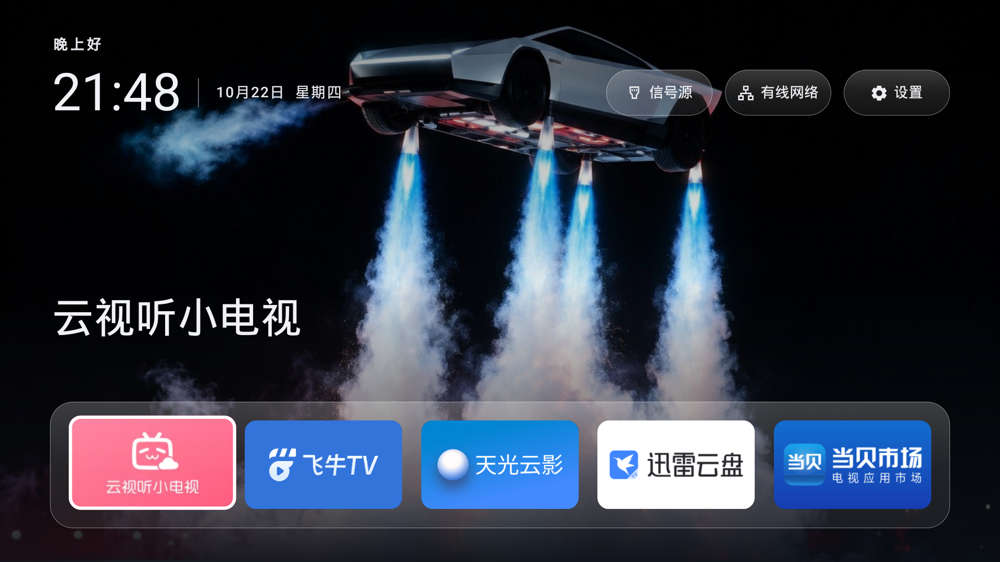
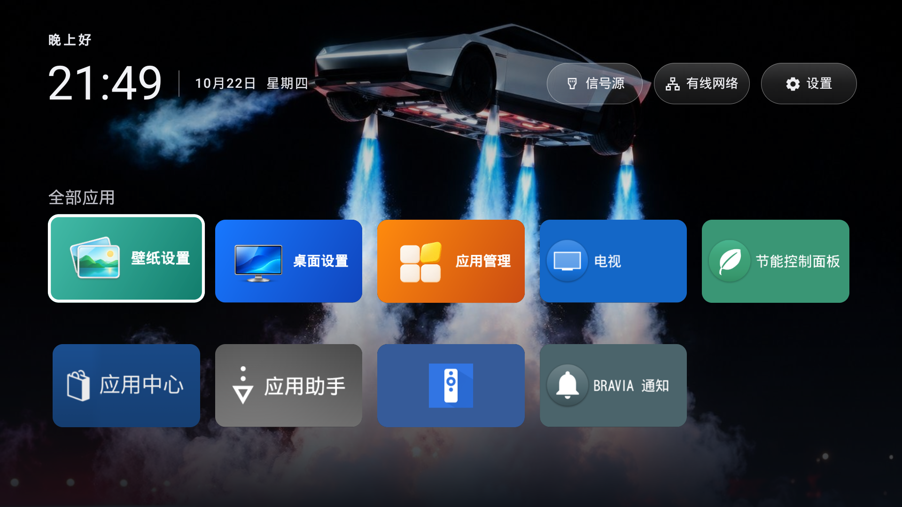
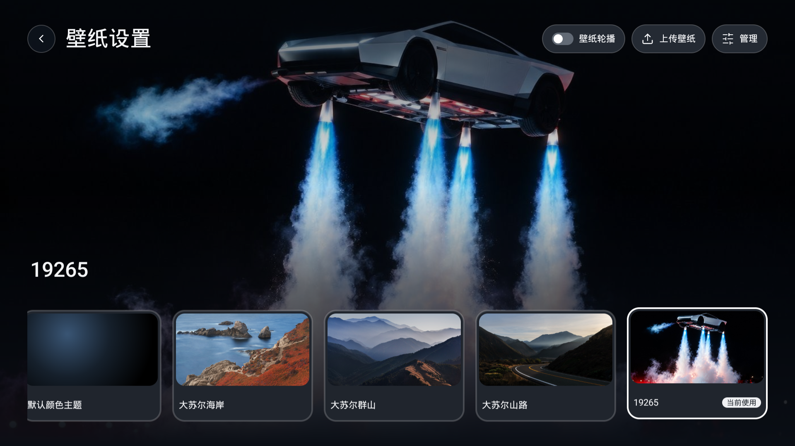

<p align="center"></p>

# Quiet TV

**一个简洁、可自定义的 Android 电视桌面。**

[简体中文](README.md)  [English](README.en.md)

把常用应用放在首页，用遥控器直接打开，方便地切换信号源、调整壁纸和管理应用。桌面没有广告和推荐信息流，无需注册账号。采用 Android 原生界面，无需 root 或刷机。

[打开安装指引](https://beatsad.github.io/quiet-tv/)：选择电视品牌，复制 Agent 安装请求，或查看手动安装与恢复方法。

[下载 1.1.2 测试版](https://github.com/BeatsAD/quiet-tv/releases/tag/v1.1.2)  [安装指南](docs/INSTALL.zh-CN.md)  [使用指南](docs/USAGE.zh-CN.md)  [兼容范围](docs/COMPATIBILITY.md)

## 下载与选包

| 电视系统 | 1.1.2 安装包 | 校验文件 |
| --- | --- | --- |
| 安卓 4.4 | [安卓4.4 测试版，构建号 35，约 4.67 MiB](https://github.com/BeatsAD/quiet-tv/releases/download/v1.1.2/QuietTV_1.1.2-35_Android4.4_Test.apk) | [SHA-256](https://github.com/BeatsAD/quiet-tv/releases/download/v1.1.2/QuietTV_1.1.2-35_Android4.4_Test.apk.sha256) |
| 安卓 5.0 及以上 | [安卓5及以上 测试版，构建号 34，约 8.94 MiB](https://github.com/BeatsAD/quiet-tv/releases/download/v1.1.2/QuietTV_1.1.2-34_Android5plus_Test.apk) | [SHA-256](https://github.com/BeatsAD/quiet-tv/releases/download/v1.1.2/QuietTV_1.1.2-34_Android5plus_Test.apk.sha256) |

**按电视系统选包，不按构建号大小选包。** 两档共用 1.1.2 的主要功能、包名与历史测试签名，不能同时安装。安卓 4.4 使用传统 TCP ADB，信号源通过系统设置或遥控器进入；不提供六位码无线配对。标准包包含 ARM32、ARM64、x86、x86_64，安卓 4.4 包不含原生库。

GitHub 下载文件使用英文名、中文显示标签，本地中文归档不变；下载时选择与 APK 同名的 `.apk.sha256`。完整更新、验证边界见 [1.1.2 发布说明](https://github.com/BeatsAD/quiet-tv/releases/tag/v1.1.2)。两档均为优化测试版，尚无正式稳定版。[历史版本](https://github.com/BeatsAD/quiet-tv/releases)及校验记录保留。

## 界面

**五个常用位置，打开电视就能找到。** 时间日期与右侧系统按钮可在桌面设置中隐藏。



**全部应用采用五列布局。** 可自定义顺序，保存、取消或恢复默认；常用应用与全部应用分别排序。



**自己的壁纸，也能放到电视上。** 支持预览、轮播、长按确定删除和恢复内置图片。在“上传壁纸”中，用同一局域网的手机扫码即可上传。



截图直接取自一台 Sony 电视，运行已核对 APK 哈希的 1.1.2／34，原始尺寸 1920×1080。保持实际界面与现有配置，未合成或重绘；详细[素材来源](docs/assets/README.md)。更多操作界面见[使用指南](docs/USAGE.zh-CN.md)。截图不代表其他型号或完整功能验收。

## 功能

| 功能 | 可以做什么 |
| --- | --- |
| 常用应用与排序 | 首页最多 5 个快捷位置；全部应用五列显示，自定义排序支持保存、取消和恢复默认。 |
| 桌面设置 | 分别控制时间日期和右侧信号源、网络、系统设置按钮的显示，选择自动保存。 |
| 壁纸 | 默认主题、内置与自定义图片、预览和每 5 分钟轮播；长按确定删除、恢复内置壁纸、同局域网扫码上传。 |
| 应用管理 | 搜索与筛选应用，查看版本和状态；按设备能力逐个启用、禁用或卸载，关键系统组件保持只读。 |
| 开机广告管理 | 检测已适配的服务，按规则停用或恢复。当前尚无经 Quiet TV 真机验收的开机广告规则，未适配设备仅供查看。 |
| 信号源与设置 | 读取本机输入列表，按检测结果提供原厂面板回退；补充部分厂商应用、系统设置和网络入口。实际切源仍需目标电视验证。 |
| 首次设置与恢复 | 试用、设置默认桌面或恢复原桌面；固件不支持切换时禁用无效操作并提示可用路径。 |
| 遥控器与焦点 | 方向键、确定、返回操作，弹簧式滚动与焦点跟随；卡片与新上传图片按显示和内存条件处理。 |
| 本地使用 | 无需云端账号，设置保存在电视；应用管理按需授权本机 ADB，关于页提供版本与离线开源许可。 |

应用管理与排序位于“全部应用 → 应用管理”。Dock 编辑、排序、桌面设置和壁纸不依赖 ADB。系统操作需单独授权；禁用保留数据，卸载删除当前用户的应用数据，恢复预装包也不会找回已删数据。详见[应用管理](docs/APP_MANAGEMENT.md)。

## 安装与试用

1. 确认电视运行 Android，按上表下载 APK 与同名校验文件，先[校验完整性](docs/INSTALL.zh-CN.md#下载安装与试用)。
2. 按[安装指南](docs/INSTALL.zh-CN.md)安装，或使用[Agent 安装与恢复说明](docs/AGENT_INSTALL.zh-CN.md)让电脑 Agent 协助。
3. 首次打开可选“暂不设置，临时使用”，先检查遥控器、应用启动和系统入口，保留原桌面。
4. 需要替换桌面时再完成[首次设置](docs/SETUP.md)，读回 HOME 组件，并分别检查实体 HOME、重启与待机唤醒。恢复入口在“应用管理 → 更多”。

覆盖更新需核对相同包名、匹配签名和递增构建号；不要通过卸载解决签名问题。设备包清单、备份和恢复记录仅保留本地，不套用其他电视的禁用清单。

## 支持范围与验证

| 系统或设备 | 范围 |
| --- | --- |
| Sony / Android 12 | 本次直接截取已发布 1.1.2／34 的首页、应用列表、壁纸、桌面设置与排序页面，并核对已安装 APK 哈希；未据此完成全量功能、重启或唤醒验收。 |
| 安卓 5.0 及以上电视 | 使用标准测试包；系统版本满足仅表示最低安装要求，厂商 HOME、ADB、设置和信号源仍需逐机确认。 |
| 安卓 4.4 | 使用独立兼容测试包；本批真实电视运行与验收待完成。 |
| 安卓 4.0～4.3、Tizen、webOS 等非 Android 系统 | 不支持。 |

两档已通过优化构建、各 49 项单元测试、Lint（0 错误，仍有警告）及签名与包元数据校验。本次截图只补充索尼页面展示，最终 APK 的逐项功能和覆盖升级数据保留仍未完整验收。投屏、长期运行、完整影音播放、真实切源及其他厂商适配需分别验证。六位码无线配对为 API33+ 且依赖设备能力的实验入口。

具体档位差异、历史证据和厂商待验收项见[兼容说明](docs/COMPATIBILITY.md)。第三方影音应用通过各自渠道更新，Quiet TV 不提供第三方应用自动更新。

遇到故障可复制 [Agent 排查提示词](docs/AGENT_DIAGNOSE.zh-CN.md)，由电脑侧 AI 指导复现并整理反馈。

## 已知兼容性问题与样机验证

**以下问题仍待解决或验证，需要其他品牌、型号和固件的真实样机协助；不能视为已修复。** 安装成功、手动启动正常或 HOME 查询结果正确，不代表开机、遥控器 HOME 键和重启后的行为均正常。当前反馈见 [Issue #35](https://github.com/BeatsAD/quiet-tv/issues/35)。

| 问题 | 当前表现与待验证内容 |
| --- | --- |
| 厂商主页接管 | 部分固件可能在开机时恢复原厂主页，或由 Home 键直接启动原厂 Activity，绕过标准 HOME 设置；冷启动、重启和待机唤醒需分别验证。 |
| 默认桌面设置失败 | 已有反馈出现 `cannot be home on user 0`；需核对实际安装包、当前用户、HOME 候选和厂商限制，原因及适配尚待确认。 |
| 默认桌面状态提示不充分 | 当前检测主要依据 HOME Intent 解析，可能显示“已是默认桌面”，但实际 Home 键或重启仍返回原厂主页；状态提示和持久行为核验仍需改进。 |
| ADB 被禁用或入口受限 | USB 调试灰色、无线调试缺失或无法取得配对码时，本机应用管理和依赖 ADB 的适配可能不可用；内置 ADB 客户端不能绕过固件封锁或配对认证，目前没有通用解锁方案。 |

当前开发源码在标准主程序中增加“桌面守护（实验）”，位于桌面设置及首次设置页面。小米／Redmi、创维／酷开设备可选择本机原主页，手动授权无障碍后启用；其他设备默认不开放，安卓4.4兼容档禁用。此功能只按精确主页窗口尝试中转，不读取屏幕内容、不改变默认 HOME、不自动禁用原桌面，详见[启用与暂停](docs/SETUP.md#桌面守护实验)。**未发布、未安装目标电视；实体 HOME、重启、待机唤醒及 HDMI／播放不被打断仍待验收。** 普通应用图标入口及小米设置／Wi-Fi 路由仍属于主程序功能。

原有[小米主页中转助手](xiaomi-home-helper/README.md)保留为独立实验方案；启用内置守护前先停用它的无障碍服务，不自动迁移或卸载。

针对已确认使用厂商主页属性的酷开 Android 8 固件，仓库另提供可选独立的[主页中转助手](coocaa-home-shim/README.md)，复用上游实现并指向 Quiet TV。**该移植尚未经过真实电视验收，不随通用包启用，也不能解锁 ADB。** 日志监听暂未实现。上游其他设备的成功记录不能代替 Quiet TV 验收；保留原桌面及本机恢复记录，不套用其他电视的系统包禁用清单。

欢迎通过 [Issue #35](https://github.com/BeatsAD/quiet-tv/issues/35) 或[新机型适配反馈](https://github.com/BeatsAD/quiet-tv/issues/new?template=device_adaptation.yml)补充样机结果：电视型号、Android／固件版本、Quiet TV 版本与安装包来源、复现步骤，以及手动启动、真实遥控器 HOME、冷启动／重启、待机唤醒、信号源和原桌面恢复的实际结果。未测试项请标为“未验证”；日志只提供相关脱敏片段，不公开 IP、序列号、密钥或完整设备转储。

## 技术实现

实现路径：Codex 编写 Android 原生桌面 → 构建 APK → ADB 安装 → 设置默认 HOME → 真机调试。日常使用无需电脑在线。

完整环境、开发者选项、连接授权、实现说明与可复制提示词见[用 Codex 复现与适配的技术路径](docs/TECHNICAL_PATH_WITH_CODEX.zh-CN.md)。电脑 ADB 用于安装，Quiet TV 内置 ADB 用于电视端管理，两者分别授权。

## 文档与参与

| 我想…… | 查看 |
| --- | --- |
| 浏览全部文档与目录职责 | [文档索引](docs/README.md) |
| 安装桌面、更新 APK 或切回原桌面 | [安装指南](docs/INSTALL.zh-CN.md) |
| 调整常用应用、壁纸和遥控器操作 | [使用指南](docs/USAGE.zh-CN.md) |
| 完成首次设置或恢复原桌面 | [首次设置与恢复](docs/SETUP.md) |
| 了解机型适配与已验证功能 | [兼容性](docs/COMPATIBILITY.md) · [验收记录](docs/COMPATIBILITY.md) |
| 开发、构建或贡献代码 | [贡献指南](CONTRIBUTING.md) · [版本与安装包规则](docs/VERSIONING.md) |
| 了解安全与仓库设置 | [安全政策](SECURITY.md) · [贡献指南](CONTRIBUTING.md) |

反馈：[Bug](https://github.com/BeatsAD/quiet-tv/issues/new?template=bug_report.yml) · [功能建议](https://github.com/BeatsAD/quiet-tv/issues/new?template=feature_request.yml) · [新机型适配](https://github.com/BeatsAD/quiet-tv/issues/new?template=device_adaptation.yml)

仓库、文档和测试包下载已公开；提交反馈需要登录 GitHub。

## 参与开发与维护

欢迎贡献 Android 原生功能、遥控器交互、文档翻译、新机型验证和测试。可以从[新人任务](https://github.com/BeatsAD/quiet-tv/issues?q=is%3Aissue%20is%3Aopen%20label%3A%22good%20first%20issue%22)或[需要帮助的任务](https://github.com/BeatsAD/quiet-tv/issues?q=is%3Aissue%20is%3Aopen%20label%3A%22help%20wanted%22)开始，先留言认领，再通过 Fork 提交 PR。

[贡献指南](CONTRIBUTING.md)提供开发环境、检查命令与评审流程；[Discussions](https://github.com/BeatsAD/quiet-tv/discussions)用于问答、方向讨论和长期维护意愿交流。参与协作请遵守[行为准则](CODE_OF_CONDUCT.md)。

本地构建需要 Git、Python 3、JDK 17、Android SDK platform 36 和 build-tools 36.0.0。先设置 `ANDROID_HOME`，或在 `local.properties` 配置自己的 `sdk.dir`，然后运行：

```sh
git clone https://github.com/BeatsAD/quiet-tv.git
cd quiet-tv
./gradlew :app:assembleDebug --console=plain
```

Debug APK 位于 `app/build/outputs/apk/debug/app-debug.apk`。构建与离线检查不需要连接电视或准备 `device.json`；安装到自己的电视时，按[安装指南](docs/INSTALL.zh-CN.md)使用 ADB，保留已有配置和备份。正式交付 APK 的归档、签名与版本要求见[版本规则](docs/VERSIONING.md)。

原生源码位于 `app/`，公开构建工具位于 `scripts/`；`prototypes/about/` 是 APK 的实际打包输入。设备数据、独立网页演示和宣传视频不随当前源码分发，完整目录说明见[文档索引](docs/README.md)。

## 致谢与许可

Quiet TV 基于 [Gathin23/tv-vibehack](https://github.com/Gathin23/tv-vibehack) 开发，感谢 **Gathin** 的原始工作。本项目独立维护，与上游及电视、应用品牌方无官方关联。

代码采用 [MIT 许可证](LICENSE)，保留原作者版权与完整许可。字体、壁纸和第三方应用素材分别遵循各自授权，详见[第三方项目与资源说明](THIRD_PARTY_NOTICES.md)。

## 保持联系


