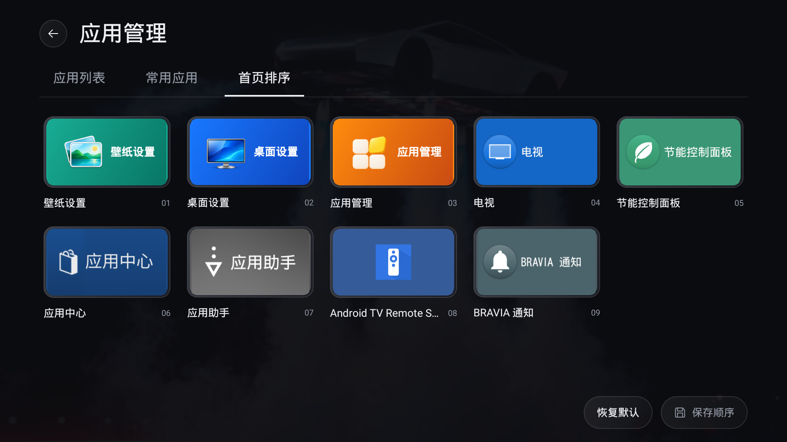
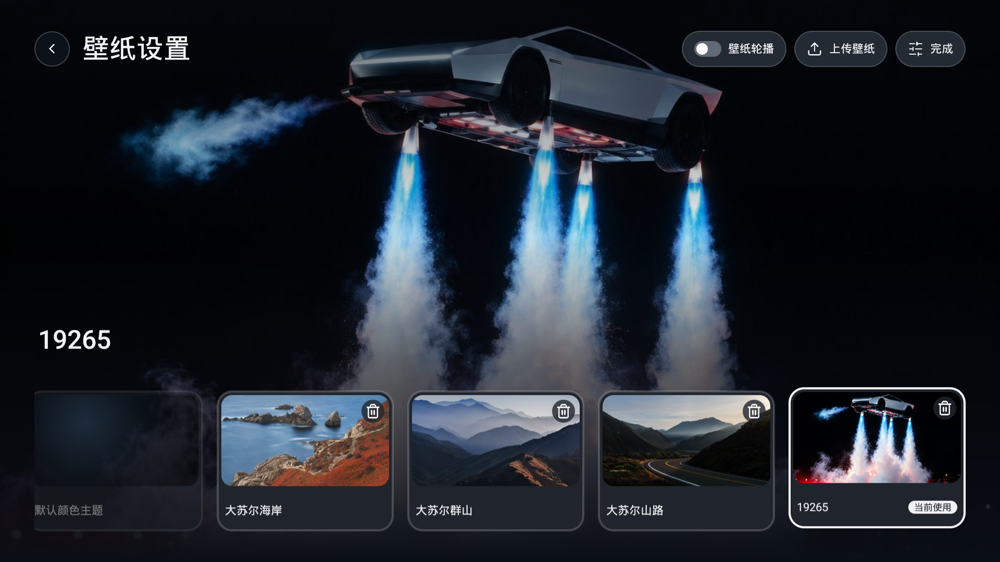
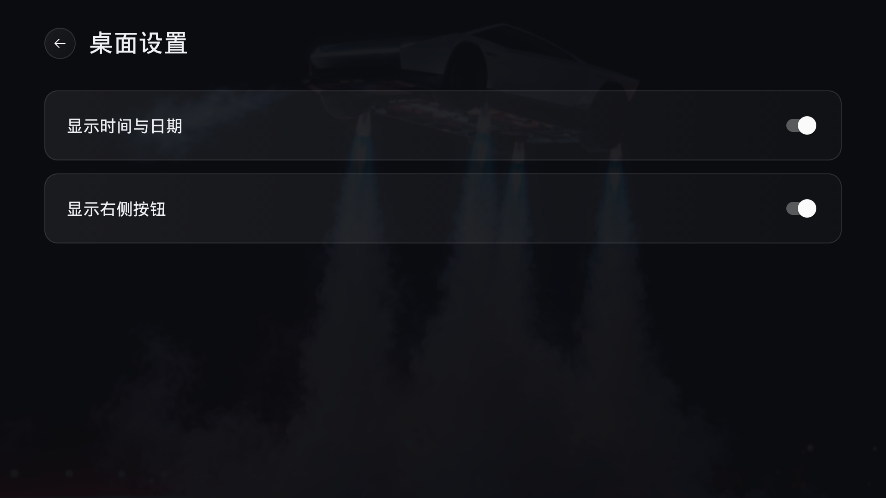

# Usage

[简体中文](USAGE.zh-CN.md) · [Home](../README.en.md)

## Remote navigation

| Key | Behavior |
| --- | --- |
| Left / Right | Move within the current row; stop at its edges |
| Up / Down | Move one row between shortcuts, dock, and grid |
| OK | Open the selected application, shortcut, or settings module |
| Back in the grid | Return to the dock |
| HOME (development source) | Return to the first screen, with focus in Favorite apps |
| Back from an application to Home (development source) | Keep the position and focus used before opening the application |

All Apps and Home order both use five columns. An incomplete last row uses the nearest valid column. Focus is saved locally for restoration. In development source, a new HOME request always takes priority and returns to the first screen; ordinary Back returns preserve the previous position. A historical build passed one Sony TV reboot. That result does not establish reboot or upgrade-state acceptance for 1.1.2.

In development builds, the greeting, clock, date, weather, top-right shortcuts and dock scroll out together when entering All Apps, in both Classic and Art Gallery layouts. All Apps uses a smaller top gap and shows a centered, single-line name below every cover; long names end with an ellipsis, and row spacing stays consistent. More apps scroll continuously by row with focus, without scrollbars, an app count or footer labels. Up from the first grid row or Back from the grid restores the original home layout and the dock item selected before entering the grid. This change is not included in published 1.1.2 APKs.

This guide describes published [1.1.2 test builds](https://github.com/BeatsAD/quiet-tv/releases/tag/v1.1.2). Images are captured on a Sony TV running standard build 34 and do not establish full feature or other-device acceptance.

## App management and Dock

Open 应用管理 (App Management) from All Apps. Management controls in this first Sony-targeted version are in Chinese.

- Dock 管理 supports up to five shortcuts: add, replace, remove, or move left/right. In development source, each reorder move saves automatically; OK or Back ends moving without undoing saved changes. Editing works without ADB.
- **Home order**: in development source, open App management → 应用排序. Press OK to select an entry, then use the arrows to move it. Each position change saves automatically; OK or Back ends moving. There are no save/reset buttons or save-on-exit prompts. Historical APKs retain their version-specific behavior. Wallpaper Settings, Desktop Settings and App Management can all move.
- Filter all, user, preinstalled, disabled, or restorable packages.
- The top-right ADB status opens local TCP connection settings (default port 5555). Enable network debugging on the TV and approve QuietTV's independent key. Six-digit wireless pairing is experimental, requires API33+ and actual device support, and is absent from legacy19.
- Operations affect one package for the current Android user. Disabling retains data; uninstalling removes that user's app data. Preinstalled uninstall leaves the system APK; install-existing is offered only when a system APK is retained and never restores deleted data.
- Quiet TV, critical components, and unverified system packages are protected from system-state changes. Operation history records configuration states, not user-data backups. Reconnect and refresh after uncertain results; do not repeat uninstall.

Disabled Dock entries retain their order and reappear when enabled. Confirmed uninstalls remove the shortcut. An explicitly empty Dock stays empty across APK updates. See [implementation and hardware evidence](APP_MANAGEMENT.md).

Development source adds 应用列表 → 更换封面 (Change cover). Scan with a phone on the same network, select and crop an image, then confirm on the TV to apply it. 恢复默认 restores the app's current original artwork after confirmation. Recommended: 720 × 406 px; minimum: 360 × 203 px. JPG, PNG or static WebP, up to 2 MB per image. AI can help create a suitable image; no generation service is included. Cover changes work without ADB and retain the original app icon and package-operation protection. Filters stay above the list; ADB, More and About share the top-right row. These changes are not included in published 1.1.2 packages. See [app covers](APP_MANAGEMENT.md#自定义应用封面) for scope and hardware acceptance limits.

Home ordering works without ADB and leaves Dock independent. In custom order, newly visible apps append at the end; updates and name changes preserve positions. Disabled or pinned apps retain their order records until shown again; uninstalls remove records. Default order puts Wallpaper Settings, Desktop Settings and App Management first, followed by apps sorted by name. Settings stay on the device across normal in-place updates; physical remote, reboot, and upgrade behavior must be accepted on each target TV.

## Boot-ad management

Open 应用管理 → 更多 for boot-ad management. Detection and actions depend on matching local rules and actual service states. Restoration uses the recorded original state; unmatched devices stay read-only. No rule has passed Quiet TV hardware acceptance yet, and this does not promise removal of every vendor ad. See [app management](APP_MANAGEMENT.md).

## Language and initial configuration

Edit `app/src/main/assets/launcher.json`, then rebuild and update the APK. `dock` supplies up to five initial package names in left-to-right order. Once migrated, edit Dock in the TV interface; bundled changes do not overwrite saved preferences. `hidden` hides entries without disabling packages. Choose `zh` or `en` for `language`, and `time` or `home` for `greeting`. The current implementation does not implement the prompt's planned automatic `system` language mode.

The included application package list belongs to the Sony adaptation. Use actual packages installed on your target device; see the [Chinese configuration example](USAGE.zh-CN.md).

## Wallpapers

Open Wallpaper Settings from All Apps. Left / Right previews; press OK or click the wallpaper card once to save the choice. Focus stays on that card after applying. Back cancels an unapplied preview and returns home. Development source removes the top-right Manage button; long-press OK and confirm to delete. Back does not undo completed deletions.

- **Default color theme:** a black background with an app-colored glow. Always available and cannot be deleted.
- **Photos and slideshow:** applying a photo disables rotation. The slideshow cycles through uploaded images every five minutes. Opening the picker or leaving the launcher pauses it; returning starts a new interval.
- **Daily wallpaper:** focus the card after Default color theme to preview; press OK or click once to apply and enable daily updates. Bing China is the only provider. Daily settings, provider selection and the update-check dialog are removed. The subtitle shows Bing China, Updates daily, and the currently cached image name when available; long names are truncated at the end. Daily mode disables local slideshow; selecting a local wallpaper leaves daily mode.
- **Daily updates and offline use:** updates run as needed when the home screen resumes, the day changes or connectivity returns. A new image is saved before replacing the previous one. Offline or failed updates keep the current wallpaper. An active legacy Btstu cache remains a temporary background until a Bing image is saved; no further Btstu requests are made. The daily card cannot be deleted and does not count towards upload limits. API and image CDN reachability depends on the network and TV firmware.
- **Bing filtering and storage (development source):** inspect metadata for the latest eight images, skip images not offered for wallpaper download, and download only the most recent eligible image. Reuse an identical or newer Bing cache without moving back to an older image. Bing uses two fixed image slots in private app storage, overwritten in turn rather than accumulated by date; each image is limited to 8 MiB. The original download temporary file is released when the request ends. Prepared images remain available offline; leaving daily mode keeps the cache. Legacy Btstu files are retained without further updates or automatic deletion. This change is unreleased.
- **Delete:** focus an image or video card and long-press OK to open its confirmation dialog. Cancel has initial focus; select Delete to remove that one wallpaper. Releasing the held key neither applies the wallpaper nor confirms deletion. Uploaded images and videos delete only the TV copy. Default color theme and Daily wallpaper cannot be deleted. Deleting the fixed current photo restores the color theme; deleting the slideshow’s current photo advances to the next. Fewer than two photos disables rotation.
- **Upload:** on the same LAN, scan the TV QR code or open its short address and enter the six-digit code. Choose an image or MP4 video, upload, then go back on the TV to preview and apply it. Uploading does not change the active wallpaper. Wi-Fi and Ethernet work without ADB, accounts or cloud storage.

Accepts JPG, PNG and static WebP: up to 20 MB and 40 megapixels per input, 20 uploaded photos, and 50 MB total processed storage. Newly saved images retain their aspect ratio and follow the actual rendering size, up to a 3840-pixel long edge; low-memory devices or memory classes below 256 MB use a 1920-pixel limit; orientation is corrected and display uses centered cropping. Transparent areas use black. Only the processed TV copy is saved; originals stay on the phone or computer. Convert HEIC to JPG before uploading.

Video wallpapers are an unreleased source feature, off by default. In the Video category, focusing a card starts a silent preview. Press OK or click once to apply; if playback is still loading, the choice saves after the first frame without another confirmation. Previewing alone keeps the active wallpaper unchanged. Switching cards or leaving cancels a pending application. Turning it off or deleting the active video restores the previous photo, daily wallpaper or slideshow. A single video loops silently, stays outside photo rotation and releases playback resources when the launcher leaves the foreground or the screen turns off. Failed playback keeps the saved wallpaper; press OK on the card to retry and apply.

Videos require MP4, at most 30 FPS and 30 MB each, with 10 videos and 500 MB including posters. Storage and decoder capabilities are checked. H.264 8bit SDR is the common format. Android 5+ conditionally accepts HEVC Main 8bit SDR and up to 4K30; Android 4.4 is limited to H.264 up to 1080p in this implementation. HDR, 10bit, 60 FPS, GIF, animated WebP and wallpaper projects are not accepted. Landscape loops of 10–60 seconds are recommended. A 4K label describes the source, not verified full-resolution output. Native 4K, sustained smoothness, screensaver and standby behavior require target-TV acceptance. Scaling the image does not reduce decoding resolution; upload an actual lower-resolution copy on weaker devices. Older systems may use a placeholder for 4K posters. Browsers unable to preview HEVC can still upload it for checking on the TV.

The server runs only while the TV upload dialog is open. Leaving it, backgrounding Quiet TV, changing network addresses, or ten idle minutes ends the session and invalidates its QR code and connection code. Reconnecting refreshes both. Five incorrect codes pause verification for 30 seconds. If connection fails, check guest-network/device isolation and try a system browser. Failed uploads and storage errors leave existing wallpapers unchanged.

Development source no longer bundles the Big Sur photos, Golden Gate video or its poster, and removes Restore built-in wallpapers. Upload your own video to populate the Video category. On upgrade, retired built-in selections return to the previous available photo or the default color theme; uploaded photos, videos and daily wallpaper caches are preserved.

APK updates preserve uploaded wallpapers; uninstalling or clearing application data removes uploaded photos. Existing selections and rotation settings migrate on first launch. Both 1.1.2 downloads include management and upload. Sony captures show the pages only; complete upload, deletion/recovery and upgrade-state acceptance remain pending. See [resource notices](../THIRD_PARTY_NOTICES.md) for provenance and licensing limits.

The upload dialog contains a local address, connection code and QR code, so its raw screenshot is kept private. Follow the current TV session; closing it invalidates that session.

## Desktop settings

Open Desktop Settings after Wallpaper Settings in All Apps. Development source uses Desktop, Weather and Guard tabs across the top. Left/right switches tabs, Down enters the active page, and Up from the first control returns to its tab. Switching pages retains settings and focus. Android 4.4 retains Desktop and Weather; Guard is unavailable.

Desktop places controls on the left and a fixed Home preview on the right. Choose Classic or Gallery, and independently show or hide greeting, time, date, weather, Inputs, Network and Settings. Changes save immediately and update the preview using the current wallpaper, favorites and usable cached weather. The preview cannot receive focus or launch apps and makes no additional weather requests. Weather and Guard use the full content area without a preview. Home uses the same layout, and switching layouts preserves visibility preferences and greeting text.

On upgrade, both time and date inherit the old combined preference once; they can then be changed independently. Unset quick-button preferences inherit the old group toggle. Remaining buttons retain their order, align right and are skipped by remote navigation when hidden. Restore them through All Apps → Desktop Settings even when all three are hidden. Published 1.1.2 packages have the original group toggle; the new layouts, live preview and independent date control are not released. Normal in-place updates retain preferences; physical remote, restart and upgrade retention still need acceptance on each target TV.

Desktop → App title controls the large title above the Dock and defaults to on. Hiding it keeps the Dock in place and updates the preview immediately. Changes apply when returning Home and persist locally across app restarts. This toggle is not included in the published packages yet.

Desktop → All apps → App names controls names below second-screen cards. It defaults to on and is independent of the Home App title setting. Hiding names preserves card spacing and order. Changes apply when returning Home and persist across restarts. Classic, Gallery and the Android 4.4 compatibility profile share this setting. This toggle is not included in the published packages yet.

## Home greeting (development source)

Open All Apps → Desktop Settings → Desktop → Home greeting. Show greeting controls the text independently of weather and time. Turning it off retains the saved text for the next time you enable it.

Select the input with your remote to use the system keyboard; Chinese input requires an installed Chinese IME. Alternatively, select Phone input, connect your phone to the TV’s local network and scan the QR code. You can also open the displayed address in a browser and enter the connection code. Sending only fills the TV draft: select Save on the TV to apply it. Cancel or Back discards both text and switch changes.

Saving empty text restores the time-based greeting. Long text is ellipsized on Home and remains complete in the editor. Existing fixed Welcome home configurations keep their text until edited. Each phone session accepts one submission and ends when you return to editing, background the app, change network addresses or leave it idle for ten minutes. Text is saved locally on the TV; no account or cloud service is required. This feature is not included in the published 1.1.2 packages above.

The Avatar row supports phone upload, change, removal and an independent visibility switch. Choose a JPG, PNG or static WebP original up to 10 MB, then drag or pinch to adjust the circular crop. The phone sends a 512 × 512 image, limited to 2 MB. The first upload enables the avatar in the draft; hiding it retains the image. It appears beside the greeting or on its own. Missing or invalid images leave no empty circle.

Uploading only updates the draft. Save on the TV applies text, avatar and both switches together; Cancel or Back keeps the saved settings. Upload sessions use a temporary QR link and connection code and end when the upload closes, the app backgrounds, the network changes or the session expires. Only the normalized avatar is kept in private app storage; original photos and location metadata are discarded. Updating the app retains saved settings, and upgrading from an older build does not add an avatar automatically.

## Home weather (development source)

Classic places the weather icon, temperature, conditions and city beside the greeting; Gallery centers the Home information. Toggle weather under All Apps → Desktop Settings → Desktop. The top Weather tab provides automatic location, city selection, refresh and service information. Turning off automatic location pins the resolved city; if no city is available, choose one first, or cancel to keep automatic location. Choosing a city turns automatic location off. City preferences remain editable while weather is hidden, without location or weather refresh requests. No ADB is needed and the system Settings button is unchanged. This feature is not included in the published 1.1.2 packages above.

With an optional private build configuration, weather queries try [QWeather](https://dev.qweather.com/en/docs/) first and fall back to [UAPI](https://uapis.cn/docs/api-reference/get-misc-weather). Builds without credentials use UAPI directly. Manual regions and system location do not require UAPI when QWeather succeeds; IP estimation still uses UAPI. Source limits are independent. HTTPS trust and hostname verification remain enabled. Home shows the weather icon, temperature, description and location. Source attribution appears separately in smaller text under Weather Settings → Service information, with a link to the corresponding official website.

Choose a location using province/city/district dropdowns or fuzzy Chinese keyword search. Both TV and phone use the bundled mainland region snapshot (31 provinces; complete Hong Kong, Macao and Taiwan divisions are not included). Duplicate district names include parent regions. On Phone input, scan the QR code on the same LAN, or open the TV address and enter the six-digit code. Sending stages a draft; only Save on TV applies it. Cancel preserves the previous region. Sessions expire after ten idle minutes and close when leaving settings. The phone never receives weather API credentials.

Weather refreshes about every 30 minutes while Home is visible. Returning Home uses cached data first; backgrounding cancels location and scheduled requests. Home shows only the weather icon, temperature, conditions and city. Updating or failed refreshes keep usable cached weather without appending “Not updated” or other status messages. Weather is hidden when no usable data exists, the cache is over six hours old, or weather display is off. Data older than one hour, refresh failures and update times remain visible in Weather settings. If the upstream observation time cannot be parsed, cache retention uses fetch time and settings explicitly report that observation time is unavailable. Missing data never becomes 0°C or a default city's weather. Free access has dynamic rate limits and no perpetual availability guarantee; a 429 pauses refresh for at least 30 minutes and respects a longer service retry delay.

Android 4.4 enables TLS 1.2 for this connection only, retaining system trust and hostname verification with no plaintext fallback. Old firmware trust stores and OEM location behavior still need hardware acceptance. Icons use local native drawing, without video, WebView or continuous animation.

## Inputs and settings

Inputs are read from the actual TV Input list. The adapted Sony exposes HDMI 1–4, AV, and Live TV. An empty channel database offers settings without automatically tuning channels. Network and Settings open their corresponding system screens.

The 1.1.2 standard profile checks known vendor input panels when the standard service is absent, restricted or empty. Only installed, enabled system components accessible to Quiet TV are offered. A single usable panel opens directly when the standard list is unavailable; multiple panels require a choice. Normal lists retain their entries and add usable system panels. BYINTEK U4's reported bogus standard list prefers its vendor panel. If a standard launch throws an error, the user can choose a system panel; a black screen without a launch error requires returning to Inputs and choosing that panel manually.

If no route is usable, a diagnostic dialog offers system settings. This does not establish that HDMI/AV ports are absent. Components and permissions are never changed automatically. See [compatibility](COMPATIBILITY.md) for the Hisense, TCL and BYINTEK candidates and hardware acceptance limits. The 1.1.2 standard APK includes this fallback; legacy19 uses settings or the physical input key.

Ethernet has been checked. Wi-Fi names depend on location permission and the system location switch; switching to Wi-Fi has not been validated on hardware. Launching a media application does not verify its account, playback, sound, or third-party service.

## Updates and recovery

Follow [installation](INSTALL.en.md) to rebuild and update Quiet TV. Third-party applications use their own update channels. System recovery requires the original baseline and journal for that exact target; never apply the included Sony recovery list to another TV.

Version 1.1.2 shares a callable app catalog across Home, sorting and favorites, adds detected OEM settings/input routes, and retains newly uploaded images up to the actual rendering size (3840px maximum, 1920px on low-memory devices). Existing photos are unchanged. Both current APKs include the shared app/image changes; vendor input routing applies to standard, while legacy19 uses system settings. See [compatibility scope](COMPATIBILITY.md#本轮源码兼容改进).
