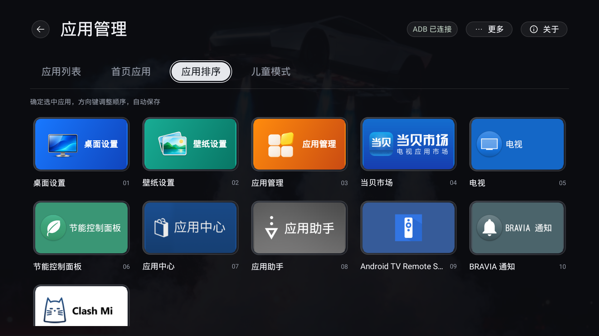
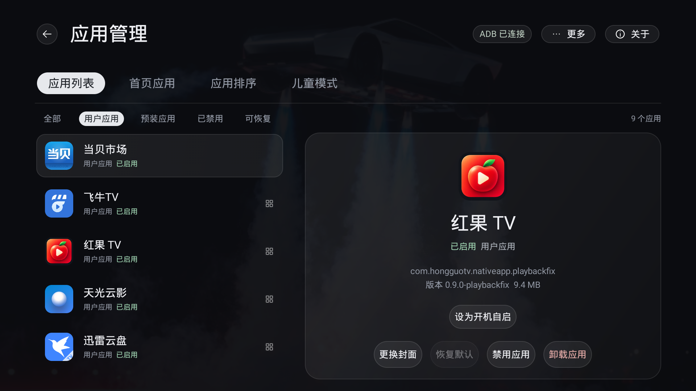
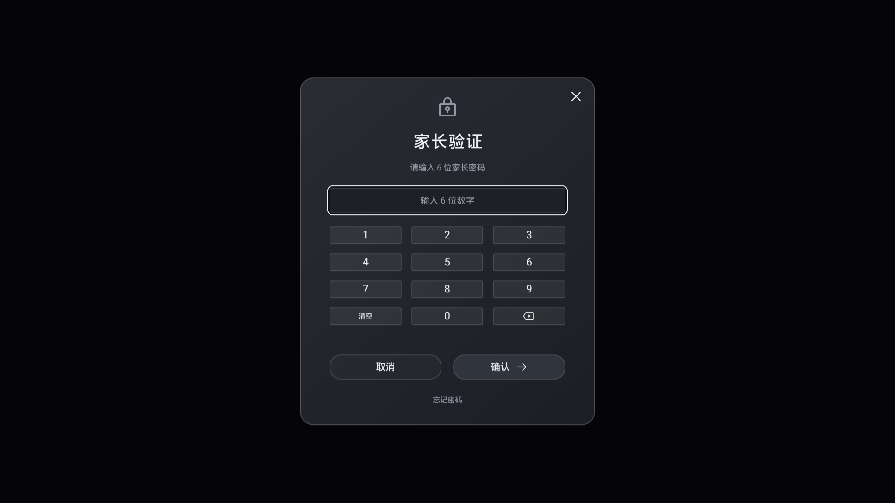
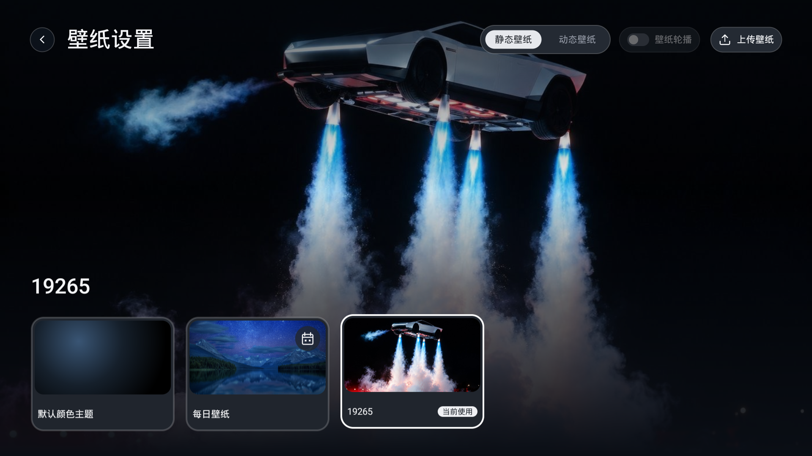
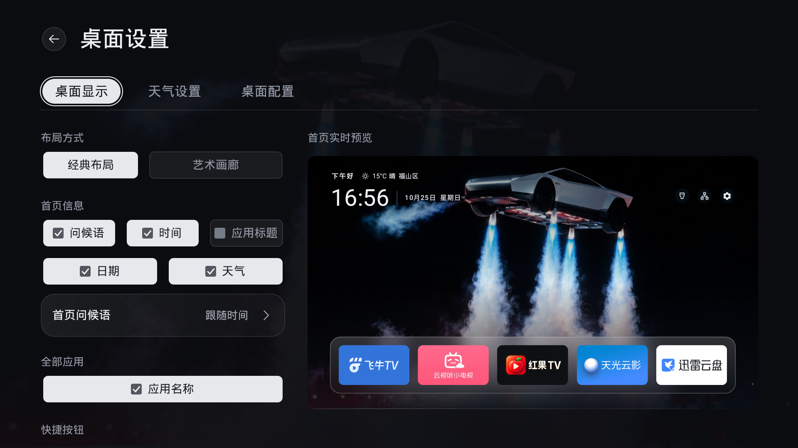
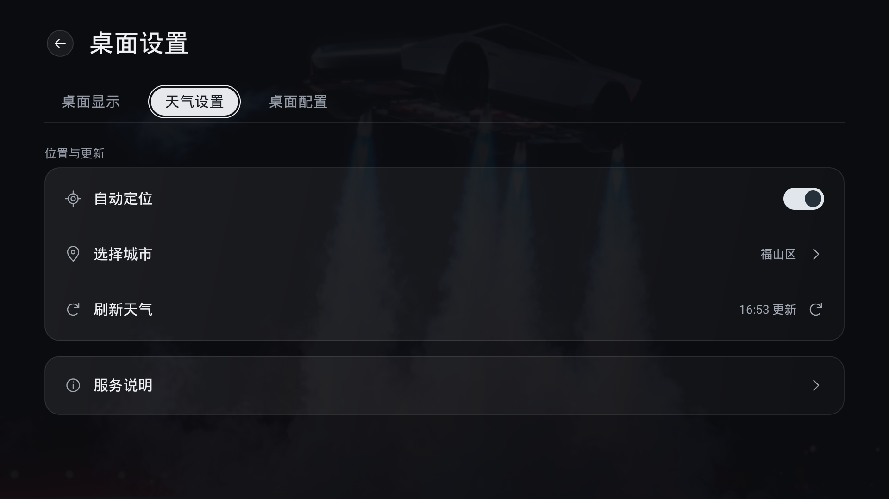
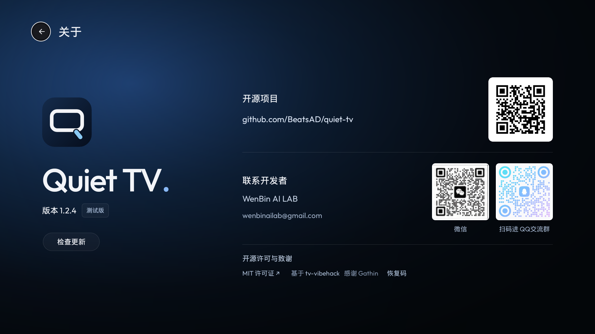

# Usage

Screenshots retain their historical 1.2.4 provenance; use the [installation page](https://beatsad.github.io/quiet-tv/) for current downloads. Computer AI configuration below describes current source and has not shipped in a new APK. Older APKs retain their own controls and interfaces.
[简体中文](USAGE.zh-CN.md)  [Home](../README.en.md)

## Remote navigation

| Key | Behavior |
| --- | --- |
| Left / Right | Move within the current row; stop at its edges |
| Up / Down | Move one row between shortcuts, dock, and grid |
| OK | Current source: a short Home press waits up to about 400ms before opening the selected entry; settings keep their normal controls |
| Double OK on Home | Two short presses within 400ms enter the screensaver, even with automatic entry off |
| Hold OK on an app | Open the application actions menu; release does not launch the app |
| Back in the grid | Return to the dock |
| HOME | Return to the first screen, with focus in Favorite apps |
| Back from an application to Home | Keep the position and focus used before opening the application |

All Apps and Home order both use five columns. An incomplete last row uses the nearest valid column. Focus is saved locally for restoration. In 1.2.4, a new HOME request always takes priority and returns to the first screen; ordinary Back returns preserve the previous position. A historical build passed one Sony TV reboot. That historical result does not establish reboot or complete upgrade-state acceptance for 1.2.4.

In 1.2.4, the greeting, clock, date, weather, top-right shortcuts and dock scroll out together when entering All Apps, in both Classic and Art Gallery layouts. All Apps uses a smaller top gap and shows a centered, single-line name below every cover; long names end with an ellipsis, and row spacing stays consistent. More apps scroll continuously by row with focus, without scrollbars, an app count or footer labels. Up from the first grid row or Back from the grid restores the original home layout and the dock item selected before entering the grid.

Historical screenshots show published [1.2.4 test builds](https://github.com/BeatsAD/quiet-tv/releases/tag/v1.2.4). Captures come directly from a Sony BRAVIA VH1 / Android 12 running published ARM32 build 64; they do not establish full feature or other-device acceptance. See [capture provenance](assets/README.md).

Without a calibrated mapping, current development source opens system settings when Home receives the standard Menu key, and the input selector for the standard TV Input key. Actions run on key release; canceled presses do not launch anything. Keys handled directly by vendor firmware and private key codes still require validation on the target model and firmware. Computer AI setup can [calibrate Home, Input and Menu](agent/remote.md); mappings save locally for the model, firmware and Android user after all three actions are confirmed.

Current source adds Desktop Settings → Desktop → Interaction feedback → Key sounds, off by default. Enable it for soft navigation, selection and back sounds; disabling it silences feedback immediately and the preference persists locally. Boundaries and automatic focus restoration stay silent; held navigation sounds play at most once per 100 ms. This affects Quiet TV only and never changes system volume or other apps. This source feature has not shipped in a new APK; TV and external-speaker sound and latency still need device acceptance.

## App management and Dock

Open 应用管理 (App Management) from All Apps. Management controls in this first Sony-targeted version are in Chinese.

Current development source adds a long-OK menu to Dock and second-screen apps. Dock supports move, replace, add, remove from Home, hide and uninstall; the second screen supports move, add to Home, hide and uninstall. Dock displays app entries only, with Add available in its long-press menu. Add/replace pickers use equal-sized rounded covers. The second screen has no title or category bar. Ordinary hidden apps can be restored from the final Hidden apps filter under Desktop Settings → App Management; parental hiding remains separate. Adding to a full Dock requires choosing a replacement. All sorting surfaces now preview swaps, save when OK puts the app down, and cancel the unfinished move with Back. This differs from the historical 1.2.4 behavior below and has not established physical-TV acceptance. User-app uninstall uses system confirmation and configured parental verification; protected components remain unavailable.

- The historical 1.2.4 首页应用 (Favorites) page supports up to five shortcuts: add, replace, remove, or move left/right. In 1.2.4, each reorder move saves automatically; OK or Back ends moving without undoing saved changes. Editing works without ADB.
- **Home order**: in 1.2.4, open App management → 应用排序. Press OK to select an entry, then use the arrows to move it. Each position change saves automatically; OK or Back ends moving. There are no save/reset buttons or save-on-exit prompts. Historical APKs retain their version-specific behavior. Wallpaper Settings, Desktop Settings and App Management can all move.
- Current development source filters All, User apps, Preinstalled apps, Disabled, Recoverable and Hidden apps, keeping package details and everyday artwork controls.
- Computer AI handles initial TCP ADB setup and device rules. App Management provides rule-scoped disable, enable, current-user uninstall and restore-install actions; published builds117/118 do not yet include these restored controls. Restoring installation does not restore deleted data.
- App Management → More → Help and recovery pauses takeover or restores the recorded original launcher. Missing records, disabled original launchers or unsupported system selection require computer recovery.
- Preserve the original launcher and recovery records. Disabling retains data; enabling a package cannot recover data removed by a historical uninstall. Inspect uncertain results before making another change.

Disabled Dock entries retain their order and reappear when enabled. Confirmed uninstalls remove the shortcut. An explicitly empty Dock stays empty across APK updates. See [implementation and hardware evidence](APP_MANAGEMENT.md).

Version 1.2.4 provides 应用列表 → 更换封面 (Change cover). Scan with a phone on the same network, select and crop an image, then confirm on the TV to apply it. 恢复默认 restores the app's current original artwork after confirmation. Recommended: 720 × 406 px; minimum: 360 × 203 px. JPG, PNG or static WebP, up to 2 MB per image. AI can help create a suitable image; no generation service is included. Cover changes work without ADB and retain the original app icon and package-operation protection. Current development source has five filters, a Connect management button and a More menu.  See [app covers](APP_MANAGEMENT.md#自定义应用封面) for scope and hardware acceptance limits.

Home ordering works without ADB and leaves Dock independent. In custom order, newly visible apps append at the end; updates and name changes preserve positions. Disabled or pinned apps retain their order records until shown again; uninstalls remove records. Default order puts Desktop Settings, Wallpaper Settings and App Management first, followed by apps sorted by name. Settings stay on the device across normal in-place updates; physical remote, reboot, and upgrade behavior must be accepted on each target TV.

App details provide Change cover and Set as startup app. This capture shows the entries without changing app state.

## Child mode

Open App Management → 儿童模式. Set a six-digit parent PIN on first use and verify it when returning. Use the on-screen numeric keypad with arrows and OK. Password recovery uses your own recovery details; do not publish a PIN or recovery code.

After parent verification, hide or lock apps and configure per-session, daily or unlimited use, with preset or custom durations. Exhausted limits open a rest screen; a parent can verify and add time. Counting needs the separate 儿童模式计时 accessibility service, distinct from desktop guard. See [child mode](APP_MANAGEMENT.md#儿童模式).

The capture shows an empty verification entry only. No password, rule or timing setting was changed.

## App autostart

Select an app in App list, choose 设为开机自启 and confirm. One app can be selected; it opens after boot or standby wake enters Quiet TV, without repeating on an ordinary HOME return. More → 开机自启 shows or clears the selection. This depends on the TV entering Quiet TV and does not establish vendor boot/wake acceptance. See [app autostart](APP_MANAGEMENT.md#开机自启开发源码).

## Boot-ad management

Current source moves boot-ad maintenance to computer AI. It requires an explicit request, a matching execution rule, original-state records and recovery checks. No Quiet TV boot-ad rule has passed hardware acceptance; no universal ad-removal claim is made. Older APKs may retain their former controls. See [app management](APP_MANAGEMENT.md#开机广告).

## Language and initial configuration

Edit `app/src/main/assets/launcher.json`, then rebuild and update the APK. `dock` supplies up to five initial package names in left-to-right order. Once migrated, edit Dock in the TV interface; bundled changes do not overwrite saved preferences. `hidden` hides entries without disabling packages. Choose `zh` or `en` for `language`, and `time` or `home` for `greeting`. The current implementation does not implement the prompt's planned automatic `system` language mode.

The included application package list belongs to the Sony adaptation. Use actual packages installed on your target device; see the [Chinese configuration example](USAGE.zh-CN.md).

## Wallpapers

In current development source, open Wallpaper Settings from All Apps. Focusing a media card only previews it. Clicking or pressing OK on the card applies the desktop wallpaper, with no separate Set wallpaper button. Set saver in the centered bottom capsule independently selects screensaver media. Cards mark both uses. Back discards unapplied previews. Older APKs retain their original controls. Version 1.2.4 removes the top-right Manage button; long-press OK and confirm to delete. Back does not undo completed deletions.

- **Default color theme:** a black background with an app-colored glow. Always available and cannot be deleted.
- **Rotation interval:** the top-toolbar Rotate capsule opens a dropdown with Off, 1, 5, 15, 30 minutes and 1 hour. Up/Down only moves focus; OK saves, while Back cancels and returns focus to the capsule. Selecting an interval starts with the previewed item. Photos and videos rotate separately in list order; the default theme and Daily wallpaper are excluded. Fewer than two items in a category disables the control and shows a hint. Existing enabled slideshows retain five minutes; disabled ones stay off. The interval survives restart. Opening the picker, entering the screensaver or leaving Home pauses the timer; returning starts a full interval. Applying a single wallpaper stops rotation but retains the interval.
- **Daily wallpaper:** focus the card after Default color theme to preview; click or press OK on the card to apply and enable daily updates. Bing China is the only provider. Daily settings, provider selection and the update-check dialog are removed. The subtitle shows Bing China, Updates daily, and the currently cached image name when available; long names are truncated at the end. Daily mode disables local slideshow; selecting a local wallpaper leaves daily mode.
- **Daily updates and offline use:** updates run as needed when the home screen resumes, the day changes or connectivity returns. A new image is saved before replacing the previous one. Offline or failed updates keep the current wallpaper. An active legacy Btstu cache remains a temporary background until a Bing image is saved; no further Btstu requests are made. The daily card cannot be deleted and does not count towards upload limits. API and image CDN reachability depends on the network and TV firmware.
- **Bing filtering and storage:** inspect metadata for the latest eight images, skip images not offered for wallpaper download, and download only the most recent eligible image. Reuse an identical or newer Bing cache without moving back to an older image. Bing uses two fixed image slots in private app storage, overwritten in turn rather than accumulated by date; each image is limited to 8 MiB. The original download temporary file is released when the request ends. Prepared images remain available offline; leaving daily mode keeps the cache. Legacy Btstu files are retained without further updates or automatic deletion.
- **Delete:** focus an image or video card and long-press OK to open its confirmation dialog. Cancel has initial focus; select Delete to remove that one wallpaper. Releasing the held key neither applies the wallpaper nor confirms deletion. Uploaded images and videos delete only the TV copy. Default color theme and Daily wallpaper cannot be deleted. Deleting the fixed current photo restores the color theme; deleting the slideshow’s current photo advances to the next. Fewer than two items in the active category disables rotation. Deleting the current rotating video selects a remaining video.
- **File transfer:** open App Management → 文件传输 to receive files from a phone or computer on the same LAN, or select authorized local/USB files. Choose Preview and set as wallpaper, then confirm; receiving alone never changes the wallpaper. A file becomes downloadable only after selecting Send to phone or computer on the TV. Receipts are limited to 200 MB per file and 500 MB total; wallpaper format and library limits still apply. See the [file-transfer guide](APP_MANAGEMENT.md#文件传输助手).

Accepts JPG, PNG and static WebP: up to 60 MB and 40 megapixels per input, 20 uploaded photos, and 50 MB total processed storage. Newly saved images retain their aspect ratio and follow the actual rendering size, up to a 3840-pixel long edge; low-memory devices or memory classes below 256 MB use a 1920-pixel limit; orientation is corrected and display uses centered cropping. Transparent areas use black. Only the processed TV copy is saved; originals stay on the phone or computer. Convert HEIC to JPG before uploading.

After choosing a photo or video on the phone upload page, you can edit its wallpaper name. The field starts with the original filename without its extension; upload directly to keep that name. Names must be non-empty, contain no slashes or backslashes, and use up to 48 characters. The name appears in the TV wallpaper list without renaming the original file. Choosing another file resets the name; failed-upload retries retain your edit. No rename action or extra confirmation is added on the TV.

Version 1.2.4 supports video wallpapers, off by default. In the Video category, focusing a card starts a silent preview. In current source, click or press OK on the card to apply; if playback is still loading, the choice saves after the first frame without another confirmation. Previewing alone keeps the active wallpaper unchanged. Switching cards or leaving cancels a pending application. Turning it off or deleting the active video restores the previous photo, daily wallpaper or slideshow. With video rotation off, the selected video loops individually. Video rotation switches after the chosen dwell interval and saves the next selection only after its first frame; playback failure keeps the original selection. Videos stay outside photo rotation and release playback resources when the launcher leaves the foreground or the screen turns off. Failed playback keeps the saved wallpaper; press OK on the card to retry and apply.

Videos accept MP4, MOV, MKV and WebM up to 60 FPS and 200 MB (200 × 1024 × 1024 bytes) each, with 10 videos and 500 MB including posters. Available storage and file parsing are checked on upload. Declared decoder capabilities are diagnostic only and do not block import; returning to the TV starts an actual decode attempt in preview, and applying waits for the first frame. Decode failures and first-frame timeouts suggest 1080p 30 FPS H.264 SDR video and keep the saved wallpaper unchanged. Android 5+ uses Media3 1.8.1 with TextureView, bounded buffering, disabled audio tracks and decoder fallback. Android 4.4 retains platform MediaPlayer and TextureView without Media3 and accepts inputs up to 1080p. Android 5+ accepts inputs up to 4K when the actual encoding, resolution and frame-rate combination is supported; 1080p60 support does not imply 4K60 support. SDR and 8-bit restrictions remain; HDR, GIF, animated WebP and wallpaper projects are not accepted. Landscape loops are recommended; portrait video is decoded at its actual encoded dimensions and center-cropped. No on-TV transcoding is performed.

The phone can preview its local file before and after upload. An unsupported browser preview does not block uploading an accepted container; the page asks the user to check playback on the TV. Phone preview does not establish TV playback compatibility. TV failures distinguish file access, unsupported format, decoding, first-frame timeout and output failure; the selected wallpaper and uploaded videos are retained, with platform/Media3 error codes in diagnostics. A 4K label describes the source, not verified full-resolution output. Native 4K, sustained smoothness, screensaver and standby behavior require target-TV acceptance. Scaling the image does not reduce decoding resolution; upload an actual lower-resolution copy on weaker devices. Older systems may use a placeholder for 4K posters.

The server runs only while the TV upload dialog is open. Leaving it, backgrounding Quiet TV, changing network addresses, or ten idle minutes ends the session and invalidates its QR code and connection code. Reconnecting refreshes both. Five incorrect codes pause verification for 30 seconds. If connection fails, check guest-network/device isolation and try a system browser. Failed uploads and storage errors leave existing wallpapers unchanged.

Version 1.2.4 no longer bundles the Big Sur photos, Golden Gate video or its poster, and removes Restore built-in wallpapers. Upload your own video to populate the Video category. On upgrade, retired built-in selections return to the previous available photo or the default color theme; uploaded photos, videos and daily wallpaper caches are preserved.

APK updates preserve uploaded wallpapers; uninstalling or clearing application data removes uploaded photos. Existing selections and rotation settings migrate on first launch. Both 1.2.4 profiles include the described management and uploads. Sony captures show the pages only; complete upload, deletion/recovery and upgrade-state acceptance remain pending. See [resource notices](../THIRD_PARTY_NOTICES.md) for provenance and licensing limits.

The upload dialog contains a local address, connection code and QR code, so its raw screenshot is kept private. Follow the current TV session; closing it invalidates that session.

## In-desktop screensaver (development source)

The wallpaper page shares its library with the screensaver. A wider single centered bottom capsule provides Set saver, automatic entry (Off, 1, 5, 10 or 15 minutes), Time and Weather. Changes save immediately. Time and Weather have no separate persistent background or border; their focus outlines appear during remote navigation. On first upgrade, automatic entry is off, media references the current wallpaper, and both information switches are on. Later wallpaper changes do not change the saver selection. Media is referenced by ID, never copied. Deleting selected saver media restores the default color background; failed saves retain the previous settings and show an error.

Idle timing runs only while Home is foreground and interactive with no settings window or popup. Remote, touch and mouse activity reset it; leaving Home, editing app order or turning the screen off stops it. Two short OK presses within 400ms enter the saver even with automatic entry off. A single Home OK therefore waits up to about 400ms. Focus movement, Back or leaving Home cancels pending confirmation; long, repeated and canceled presses cannot double-click. Settings retain their normal controls.

The first ordinary key or click only wakes Home, consuming the complete down/up gesture and restoring focus. Power, HOME and volume retain their system behavior. Saver playback uses the existing decoder, pauses slideshow, stays muted without changing wallpaper sound, and retains a cover until the first video frame. Exit restores the background before desktop controls. Time uses system time and timezone; weather shares existing location, source and cache with independent visibility and hides when unavailable.

Standard and Android 4.x share configuration, state and input logic, with their existing Media3 and platform MediaPlayer paths. Sony remote feel, duplicate reports, sustained playback and standby wake still require target-TV acceptance. This source documentation does not indicate that published APKs include the feature.

## Desktop settings

Open Desktop Settings from All Apps. Current source shares seven tabs in this order: Desktop, Weather, App Management, Child mode, File transfer, Updates and Diagnostics. Home apps and App order tabs have been removed; use the desktop long-press menu to add, replace, remove or move apps. Old page entries and saved page states open App Management while retaining favorites and ordering. Computer AI handles technical setup. Historical 1.2.4 standard APKs also have Home setup. Use App Management → More → Help and recovery to pause or restore the original launcher. A pause does not change system HOME, and restoration retains a previously selected ADB-retention preference. See [setup and recovery](SETUP.md).

Desktop places controls on the left and a fixed Home preview on the right. Choose Classic or Gallery, and independently show or hide greeting, time, date, weather, Inputs, Network and Settings. Changes save immediately and update the preview using the current wallpaper, favorites and usable cached weather. The preview cannot receive focus or launch apps and makes no additional weather requests. Weather uses the full content area without a preview. Home uses the same layout, and switching layouts preserves visibility preferences and greeting text.

On upgrade, both time and date inherit the old combined preference once; they can then be changed independently. Unset quick-button preferences inherit the old group toggle. Remaining buttons retain their order, align right and are skipped by remote navigation when hidden. Restore them through All Apps → Desktop Settings even when all three are hidden. Version 1.2.4 provides the described layouts, live preview and independent display settings. Normal in-place updates retain preferences; physical remote, restart and upgrade retention still need acceptance on each target TV.

Desktop → App title controls the large title above the Dock and defaults to on. Hiding it keeps the Dock in place and updates the preview immediately. Changes apply when returning Home and persist locally across app restarts. This toggle is not included in the published packages yet.

Desktop → All apps → App names controls names below second-screen cards. It defaults to on and is independent of the Home App title setting. Hiding names preserves card spacing and order. Changes apply when returning Home and persist across restarts. Classic, Gallery and the Android 4.4 compatibility profile share this setting. This toggle is not included in the published packages yet.

## Home greeting

Open All Apps → Desktop Settings → Desktop → Home greeting. Show greeting controls the text independently of weather and time. Turning it off retains the saved text for the next time you enable it.

Select the input with your remote to use the system keyboard; Chinese input requires an installed Chinese IME. Alternatively, select Phone input, connect your phone to the TV’s local network and scan the QR code. You can also open the displayed address in a browser and enter the connection code. Sending only fills the TV draft: select Save on the TV to apply it. Cancel or Back discards both text and switch changes.

Saving empty text restores the time-based greeting. Long text is ellipsized on Home and remains complete in the editor. Existing fixed Welcome home configurations keep their text until edited. Each phone session accepts one submission and ends when you return to editing, background the app, change network addresses or leave it idle for ten minutes. Text is saved locally on the TV; no account or cloud service is required.

The Avatar row supports phone upload, change, removal and an independent visibility switch. Choose a JPG, PNG or static WebP original up to 10 MB, then drag or pinch to adjust the circular crop. The phone sends a 512 × 512 image, limited to 2 MB. The first upload enables the avatar in the draft; hiding it retains the image. It appears beside the greeting or on its own. Missing or invalid images leave no empty circle.

Uploading only updates the draft. Save on the TV applies text, avatar and both switches together; Cancel or Back keeps the saved settings. Upload sessions use a temporary QR link and connection code and end when the upload closes, the app backgrounds, the network changes or the session expires. Only the normalized avatar is kept in private app storage; original photos and location metadata are discarded. Updating the app retains saved settings, and upgrading from an older build does not add an avatar automatically.

## Home weather

Classic places the weather icon, temperature, conditions and city beside the greeting; Gallery centers the Home information. Toggle weather under All Apps → Desktop Settings → Desktop. The top Weather tab provides automatic location, city selection, refresh and service information. Turning off automatic location pins the resolved city; if no city is available, choose one first, or cancel to keep automatic location. Choosing a city turns automatic location off. City preferences remain editable while weather is hidden, without location or weather refresh requests. No ADB is needed and the system Settings button is unchanged.

Current development source supports QWeather, UAPI, OpenWeather and Open-Meteo. Weather source selects automatic failover or one fixed provider. Fixed-provider failures retain usable cache without silently switching. Automatic mode tries configured QWeather, UAPI and configured OpenWeather sequentially, skipping unsupported places. Open-Meteo is off by default because its free endpoint is for non-commercial use only; select it explicitly or enable Open-Meteo fallback to try it last. Enabling it explains the terms; Service information links attribution, licensing and the provider website. Rate limits are independent. Optional private build credentials are documented in [Contributing](../CONTRIBUTING.md#可选天气源配置--optional-weather-configuration). Clean builds still work with UAPI without credentials.

Weather places retain their own names and available coordinates independently of current administrative codes. Changdao and its former-county aliases use a reference point near the former county seat, rather than relabeling Penglai weather. This does not establish accuracy for every island. UAPI cannot represent standalone coordinate places and is skipped or reports that another source is needed. Open-Meteo current conditions are model estimates, not proof of a local station observation. Overseas connectivity, old Android HTTPS and island accuracy still require target-network and TV acceptance.

Existing manual selections and cache remain compatible. When online, independent administrative lookup can enrich an existing selection with coordinates; lookup failure preserves the selection and the QWeather name-lookup compatibility path. System coordinates can query coordinate providers directly without district lookup, using “Current location” if no name is available. IP estimation still requires UAPI. HTTPS verification stays enabled, and missing data never becomes 0°C or another place’s weather.

Automatic location prefers the system network provider. Missing services, unavailable providers, insufficient permission or location API exceptions fall back directly to IP estimation; a normal location request waits at most five seconds. Failed cancellation does not block Home startup or return, and late location callbacks cannot refresh twice. Manual cities and disabled weather do not acquire the system location service. Choose a city manually if IP estimation is inaccurate.

Choose a location using province/city/district dropdowns or Chinese keyword search. Typing searches bundled regions and supplemental place aliases offline; explicitly pressing Search also queries UAPI. Online results retain coordinates; streets and towns become independent places instead of using their parent district’s weather. Both TV and phone use the same place catalogue. Search requests and weather calls are separate, and unavailable online search leaves local selection usable. Complete Hong Kong, Macao and Taiwan divisions are not bundled. Phone input remains LAN-only: scan the QR or enter the six-digit code, send a candidate, then select Save on TV. The phone can only submit candidates offered by that session, never arbitrary coordinates or credentials. Cancel keeps the previous selection, and sessions expire after ten idle minutes.

Weather refreshes about every 30 minutes while Home is visible. Returning Home uses cached data first; backgrounding cancels location and scheduled requests. Home shows only the weather icon, temperature, conditions and city. Updating or failed refreshes keep usable cached weather without appending “Not updated” or other status messages. Weather is hidden when no usable data exists, the cache is over six hours old, or weather display is off. Data older than one hour, refresh failures and update times remain visible in Weather settings. If the upstream observation time cannot be parsed, cache retention uses fetch time and settings explicitly report that observation time is unavailable. Missing data never becomes 0°C or a default city's weather. Free access has dynamic rate limits and no perpetual availability guarantee; a 429 pauses refresh for at least 30 minutes and respects a longer service retry delay.

Android 4.4 enables TLS 1.2 for this connection only, retaining system trust and hostname verification with no plaintext fallback. Old firmware trust stores and OEM location behavior still need hardware acceptance. Icons use local native drawing, without video, WebView or continuous animation.

## Inputs and settings

Inputs are read from the actual TV Input list. The adapted Sony exposes HDMI 1–4, AV, and Live TV. An empty channel database offers settings without automatically tuning channels. Network and Settings open their corresponding system screens.

The standard profile checks known vendor input panels when the standard service is absent, restricted or empty. Only installed, enabled system components accessible to Quiet TV are offered. A single usable panel opens directly when the standard list is unavailable; multiple panels require a choice. Normal lists retain their entries and add usable system panels. BYINTEK U4's reported bogus standard list prefers its vendor panel. If a standard launch throws an error, the user can choose a system panel; a black screen without a launch error requires returning to Inputs and choosing that panel manually.

If no route is usable, a diagnostic dialog offers system settings. This does not establish that HDMI/AV ports are absent. Components and permissions are never changed automatically. See [compatibility](COMPATIBILITY.md) for the Hisense, TCL and BYINTEK candidates and hardware acceptance limits. The standard APK includes this fallback; legacy19 uses settings or the physical input key.

Ethernet has been checked. Wi-Fi names depend on location permission and the system location switch; switching to Wi-Fi has not been validated on hardware. Launching a media application does not verify its account, playback, sound, or third-party service.

## Updates and recovery

Current source provides App Management → 版本更新 (Version updates) → Check for updates. Older APKs may still use About. Automatic checks run every 24 hours while Home is in the foreground. The signed 1.2.4 feed is live. A matching newer software version shows a badge; after choosing Download, available sources are tried and the APK hash, package, version, system, architecture and signer are verified before user-confirmed installation.

A higher build of the same software version is not offered as an update. Versions without the entry need [manual installation](INSTALL.en.md). Installation restrictions or missing compatible packages do not trigger uninstalling, clearing data or forced downgrades. See [in-app updates](UPDATES.md).

Third-party apps update through their own channels. [Stock-home recovery](SETUP.md) uses this device's own original records, never another TV's system-package list.

The current version shares a callable app catalog across Home, sorting and favorites, adds detected OEM settings/input routes, and retains newly uploaded images up to the actual rendering size (3840px maximum, 1920px on low-memory devices). Existing photos are unchanged. Both profiles include the shared app/image changes; vendor input routing applies to standard, while legacy19 uses system settings. See [compatibility scope](COMPATIBILITY.md#本轮源码兼容改进).

### Current-source additions: files and parent verification

Files / USB imports a selected image or video into app storage before preview and application; originals are unchanged and USB can be removed after a successful import. The system picker is preferred. Older systems can browse readable storage with permission if no picker exists; newer systems require a system file grant, with LAN upload still available. Video wallpaper sound is off by default, persists when changed, and stops when leaving Home or turning the screen off.

Parent verification starts automatically after six digits. Creating or resetting a password still requires confirmation. Parents save their recovery code separately; the forgotten-password flow only accepts an existing code, and viewing the stored code requires parent verification. Timer rules can be saved before the accessibility service is ready, with an explicit inactive status. Entering the service configuration page does not enable the service. On-device expiry enforcement remains a separate validation step.
